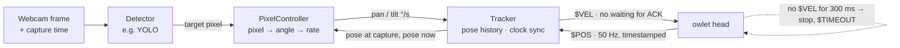
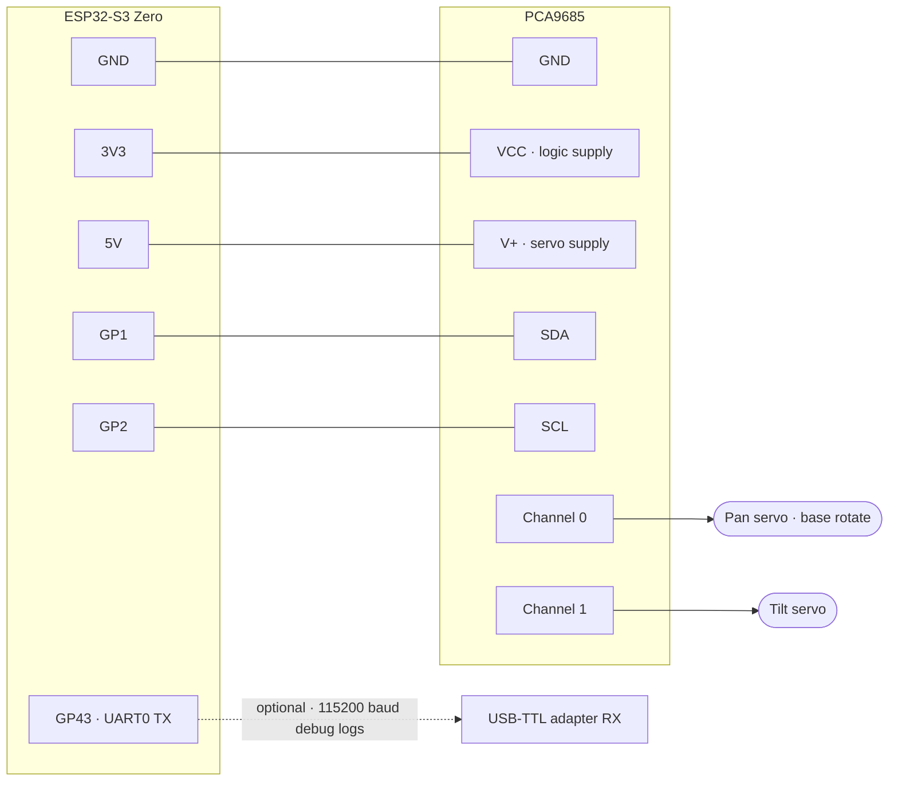
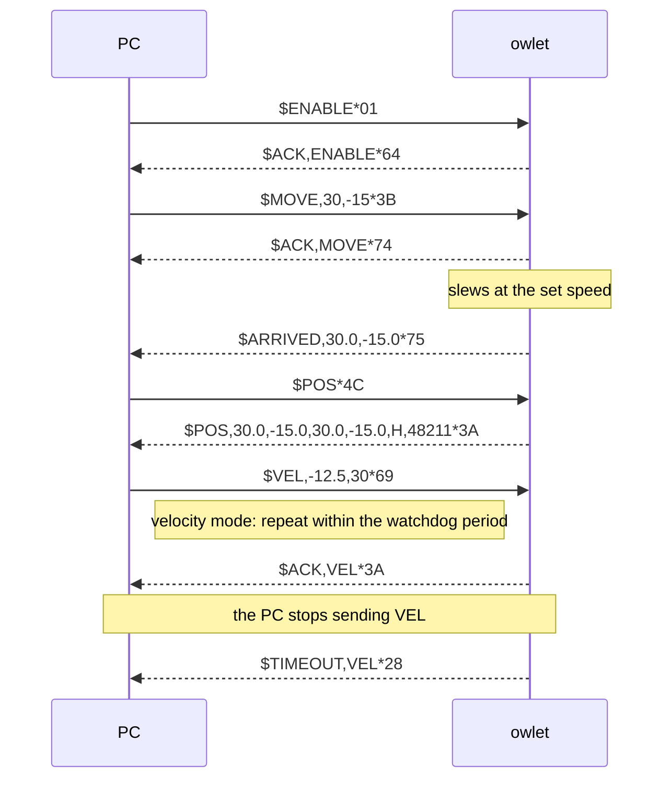
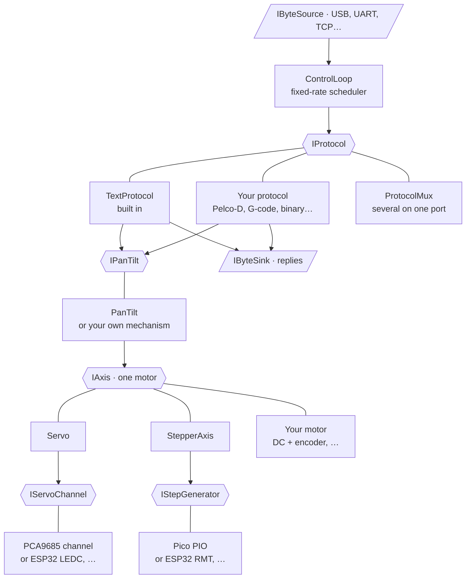

<h1 align="center">🦉 owlet</h1>

<p align="center">
  <b>A USB pan-tilt head you can drive from any computer, in any language, built for camera tracking.</b><br>
  ESP32-S3 + servos, or Raspberry Pi Pico + steppers · one USB cable · a plain-text protocol with checksums
</p>

<p align="center">
  <a href="LICENSE"></a>
  
  
  
  
  
</p>

```console
$ owlet enable
$ owlet move 30 -15 --wait
pan   30.0  tilt  -15.0   target   30.0  -15.0   holding
```

---

## Contents

- [Features](#features)
- [How it works](#how-it-works)
- [Object tracking](#object-tracking)
- [Hardware](#hardware)
- [Quick start](#quick-start)
- [Usage](#usage)
  - [Command-line tool](#command-line-tool)
  - [Python library](#python-library)
  - [Any other language: the wire protocol](#any-other-language-the-wire-protocol)
  - [No hardware? Use the simulator](#no-hardware-use-the-simulator)
- [Protocol reference](#protocol-reference)
- [Extending owlet](#extending-owlet)
- [Using owlet as a git submodule](#using-owlet-as-a-git-submodule)
- [Configuration and calibration](#configuration-and-calibration)
- [Safety](#safety)
- [Building from source](#building-from-source)
- [Project layout](#project-layout)
- [Troubleshooting](#troubleshooting)
- [Project status and roadmap](#project-status-and-roadmap)
- [Contributing](#contributing)
- [License](#license)
- [Acknowledgements](#acknowledgements)

---

## Features

- **Plug in and go.** The board's own USB port shows up as a standard serial port (`/dev/ttyACM*`, `COMx`, `/dev/cu.usbmodem*`). No drivers, no USB-TTL adapter.
- **Human-readable, checksummed protocol.** One line per message, like `$MOVE,30,-15*3B`. You can type them in a terminal or generate them from any language, and every frame is integrity-checked.
- **Know where it is, and when.** Poll the position with `$POS` or stream it at up to 50 Hz. Every report is timestamped with the device clock, and the client maps those timestamps onto your PC's clock, so you can ask "where was the camera pointing when this frame was taken?"
- **It tells you; you don't have to ask.** The head reports what it notices as it happens: a move arriving, the watchdog firing, a motor driver raising a fault. In Python you connect a function to each (`head.arrived.connect(...)`) and it is called when the time comes. Inside the firmware the same idea holds: whatever notices a change announces it once, and nothing polls.
- **It can say what went wrong.** `owlet dtc` lists every kind of trouble since power-up, with how often, when, and what to check.
- **Self-describing.** The head reports its capabilities (`$CAPS`), its calibration (`$CAL`) and, on the stepper head, what its motor drivers say about themselves (`$DIAG`: current, load, faults), so clients adapt instead of probing. Calibrate once from the PC; it's stored on the device and survives power cycles and reflashing.
- **Made for tracking.** Velocity mode (`$VEL`) turns at the rates your controller asks for, and a **watchdog** stops the head if your program stops talking to it. A ready-made `Tracker` and pixel-to-rate controller plug straight into a YOLO/OpenCV loop.
- **Smooth, speed-limited motion.** Motion is timed from the actual elapsed time, so it doesn't speed up or slow down with loop timing. Servos slew at a constant 1 to 500 °/s; steppers ramp up and down at a set acceleration and count every step.
- **Safe by default.** The motors are limp at power-up and nothing moves until you explicitly enable it.
- **Swap the motors, the board or the link.** The core talks to three small interfaces: an axis (`IAxis`), a platform (clock, serial port, storage) and a byte stream. Two heads ship from the same core: an ESP32-S3 with hobby servos, and a Raspberry Pi Pico with belt-driven steppers. Adding another is one driver class or one platform folder, not a rewrite.
- **Pluggable protocols (SOLID).** The firmware core knows nothing about any wire format. Protocols are `IProtocol` plug-ins injected at start-up, several can share the USB port, and you can add your own (Pelco-D, G-code, binary, …) without touching owlet's code.
- **Submodule-friendly.** CMake `owlet::` targets, an ESP-IDF component list, and a `pip`-installable client.
- **Batteries-included PC side.** A `pip`-installable Python library and an `owlet` command with port auto-detection, a live position view, and an interactive shell.
- **Hardware-free development.** A host simulator runs the *real* firmware logic behind a virtual serial port.
- **Efficient.** No heap, no exceptions, fixed buffers, integer formatting, and input handed to protocols a chunk at a time. The whole firmware is about 230 KB.
- **Tested.** 490 automated tests: 368 C++ unit and integration tests, plus 122 Python tests, including end-to-end runs against the simulator that check latency and clock accuracy against known values, and an opt-in suite that runs on a real head. Every finding from an adversarial review has a regression test.

## How it works


The firmware runs a fixed-rate loop (100 Hz on the servo head, 500 Hz on the stepper head). Each pass it advances both axes (position move or velocity mode, plus the watchdog), delivers whatever that step announced (an arrival, a timeout, a fault) to the parts that react to it, sends the streamed position if one is due, then reads and answers any complete command lines from USB. All of that logic is platform-independent C++ that is unit-tested on a normal PC. The board-specific code only connects it to the real USB port, clock and motor outputs.

The picture above is the servo head. The stepper head swaps the right-hand side for a Raspberry Pi Pico driving two TMC2209 modules; the PC side, the protocol and the core are identical. See [Hardware](#hardware).

## Object tracking

owlet is designed to be the motion half of a camera tracker: the PC runs the detector, and owlet turns the camera.



```python
import time
from owlet import Owlet, PixelController, Tracker

ctl = PixelController(fov_h_deg=70, fov_v_deg=43, gain=3.0)    # your camera's field of view

with Owlet() as head:
    head.enable()
    with Tracker(head, stream_hz=50, watchdog_ms=300) as tr:   # syncs clocks, streams pose
        while True:
            frame, t_capture = grab_frame()                     # t_capture = time.monotonic()
            target = detect(frame)                              # e.g. YOLO → pixel centre
            if target is None:
                tr.set_rates(0, 0)
                continue
            pan, tilt = ctl.update(target.x, target.y, frame.width, frame.height,
                                   pose_at_capture=tr.pose_at(t_capture),
                                   pose_now=tr.pose_at(time.monotonic()))
            tr.set_rates(pan, tilt)                             # $VEL, no waiting for the ACK
```

| Piece | What it does |
|-------|--------------|
| `$VEL,<pan>,<tilt>` | Turn at signed rates (°/s). A new command replaces the old one immediately; nothing queues. |
| Watchdog (`$WATCHDOG`) | If no `VEL` arrives within the timeout (default 500 ms), the head stops by itself and reports `$TIMEOUT,VEL`. A crashed tracker can't leave the head spinning. |
| Timestamped `$POS` | Each streamed pose carries the device time it was computed. |
| `Tracker` | Background reader that syncs the device clock (minimum round-trip sample of 32 randomly spaced `$CLOCK`s, refreshed every second; within ~1 ms on the reference head), keeps a pose history and sends rates fire-and-forget. If the link breaks or the device reboots, `tr.failed` is set, `tr.last_error` says why, and `set_rates()` raises rather than failing silently. |
| `PixelController` | Pixel offset → angle (pinhole geometry) → rate (gain, deadband, rate limit). Given the pose at capture and the pose now, it subtracts the motion that happened while the detector was running. |

A complete webcam + YOLO script is in [`tools/python/examples/track_object.py`](tools/python/examples/track_object.py):

```bash
pip install ./tools/python opencv-python ultralytics
python tools/python/examples/track_object.py --target person --fov-h 70 --fov-v 43 --show
```

## Hardware

There are two reference heads. Both speak the same protocol and run the same core, so the client and everything built on it work with either.

> **The servo head is untested on the current firmware.** It was last run on real hardware with firmware 0.3.0. Everything added since (the motor-neutral axis layer, events, trouble codes, limit switches) builds for the ESP32-S3 and passes the PC tests and the simulator, which use the servo code, but it has not been flashed to a servo head again. Treat this path as unverified until someone re-runs it: `./build.py --esp --flash`, then `owlet selftest`. The stepper head is the one in active use.

| | Servo head | Stepper head |
|---|---|---|
| Board | ESP32-S3 Zero | Raspberry Pi Pico (RP2040) |
| Motors | 2× hobby servo via PCA9685 | 2× NEMA 17 via TMC2209, 3:1 belt |
| Position | absolute, ±90° | relative: where it is at `enable` is taken as the pose you give |
| Smallest step | about 0.44° | 0.0375° |
| Top speed | 500 °/s | 240 °/s (ran clean at 360) |
| Travel | ±90° | set per rig, up to pan ±180° and tilt ±135° (factory ±90° / ±60°) |
| Status | last verified on hardware with firmware 0.3.0; **untested on 0.5.0** | verified on hardware with firmware 0.5.0: self-test up to 240 °/s, pan ±180° and tilt ±135° swept slowly by eye |

### Servo head: bill of materials

*Untested on the current firmware; see the note above.*

| Qty | Part | Notes |
|----:|------|-------|
| 1 | [Waveshare ESP32-S3 Zero](https://www.waveshare.com/wiki/ESP32-S3-Zero) | Any ESP32-S3 board with native USB should work if you adjust the pins |
| 1 | PCA9685 16-channel PWM board | The common blue breakout, I²C address `0x40` |
| 2 | 180° hobby servos (MG90S/SG90 class) | Channel 0 = pan (base rotate), channel 1 = tilt |
| 1 | Pan-tilt bracket / printed mechanism | |
| 1 | USB-C data cable | |
| — | *Optional:* separate 5 V supply for servos | Recommended once the head carries a load |
| — | *Optional:* USB-TTL adapter | Only for reading firmware debug logs |

### Servo head: wiring



> **Power note:** two small servos can run off the ESP's USB 5 V for bench testing. Under load, or if the board resets when the servos move (a brown-out), power `V+` from a separate 5 V supply and keep the grounds connected.

### Stepper head: bill of materials

| Qty | Part | Notes |
|----:|------|-------|
| 1 | Raspberry Pi Pico or pin-compatible RP2040 board | Powered from USB, which also carries the protocol |
| 2 | TMC2209 StepStick modules | Step/dir for motion; the firmware sets the motor current over each driver's UART pin |
| 4 | Limit switches (lever microswitches) | Optional, two per axis. Supported in the firmware; not yet fitted to the reference head |
| 2 | NEMA 17 pancake steppers (1.8°, about 23 mm long) | |
| 2 | GT2 20T pulley (5 mm bore), 60T pulley, 200 mm closed belt | 3:1 reduction per axis |
| 4 | 625ZZ bearings · 5 mm shafts, 80 mm and 120 mm | |
| 1 | 12 V supply, 2 A or more | A USB-C PD trigger board set to 12 V works |
| 2 | 100 µF 25 V capacitors | One per driver; optional if the supply has a large output capacitor on short wires |
| 1 | LED + resistor | Optional activity light |
| — | Printed parts | [`mechanical/stepper-head/`](mechanical/stepper-head/) |

### Stepper head: wiring


| Pico pin | Goes to | |
|----------|---------|---|
| `GP2` / `GP3` | Pan driver `STEP` / `DIR` | |
| `GP6` / `GP7` | Tilt driver `DIR` / `STEP` | Note the order: the reverse of the pan pair |
| `GP8` | `EN` on both drivers | Active low; the firmware keeps it high (motors off) until `enable` |
| `GP12` / `GP13` | `MS1` / `MS2` on both drivers | Microstep select, set by the firmware (1/16) |
| `GP4` + `GP5` | `PDN/UART` on the pan driver | TMC2209 UART, one private line per driver: the firmware sets the motor current over it and reads load and faults (`owlet diag`) |
| `GP0` + `GP1` | `PDN/UART` on the tilt driver | As above |
| `GP22` | Activity LED cathode (`3V3` → resistor → LED → `GP22`) | The pin sinks the LED; lit while the head is moving |
| `3V3(OUT)` | `VIO` on both drivers | |
| `GND` | Driver grounds and supply negative | |

`GP10`/`GP11` (pan) and `GP14`/`GP15` (tilt) are set aside for the limit switches. 12 V goes to `VM` on the drivers only, never to the Pico. Pin tables, the driver pinout and a staged bring-up order are in [`docs/wiring/pico-tmc2209/`](docs/wiring/pico-tmc2209/README.md).

## Quick start

You need [Nix](https://nixos.org/download) with [flakes enabled](https://nixos.wiki/wiki/Flakes). It supplies every tool at a pinned version, so nothing else needs installing.

```bash
git clone https://github.com/Mrunmoy/owlet.git && cd owlet
nix develop                        # all tools; first run downloads them
sudo tools/dev/install-udev.sh     # Linux, once: USB access without sudo
tools/dev/doctor.sh                # is this machine ready?
./build.py --host -t               # build and run every test on the PC
./build.py --pico --flash          # stepper head   (or: ./build.py --esp --flash  for the servo head)
owlet ping                         # owlet 0.5.0 (protocol v3) on /dev/ttyACM0
owlet selftest                     # exercise both motors and report
```

That is the whole path from a clone to a tested head. **[`docs/GETTING_STARTED.md`](docs/GETTING_STARTED.md)** goes through it step by step: what each command does, how to try everything with no hardware, and what to do when a step fails.

A few things worth knowing straight away:

- **Flashing the Pico needs no button.** The script asks the running firmware to reboot into its bootloader. Only a board running firmware that ignores the request needs `BOOTSEL` held while plugging in, once.
- **The motors boot limp**, so `owlet enable` is always the first step. See [Safety](#safety).
- **The stepper head has no position sensor yet.** Centre it by hand before enabling: wherever it is then becomes 0, 0. `owlet enable 20 0` instead tells it "you are at pan 20 right now"; a stepper never jumps on enable.
- **`owlet` is already on your `PATH` inside `nix develop`.** Don't `pip install` there: Nix's Python is read-only. Outside Nix, any machine with Python 3.9+ can use the client with `pip install ./tools/python`.

```bash
owlet enable                # motors energise and hold
owlet move 20 0 --wait      # pan 20° to the camera's right, and wait until it is there
owlet pos                   # where is it?
owlet disable               # motors go limp
```

## Usage

### Command-line tool

```text
owlet [-p PORT] [-t TIMEOUT] <command> [args]
```

| Command | What it does |
|---------|--------------|
| `owlet ports` | List connected boards that look like an owlet |
| `owlet ping` | Check the link; print firmware and protocol versions |
| `owlet enable [PAN TILT]` | Energise the motors, optionally at a given pose |
| `owlet disable` | Turn the motors off (limp) |
| `owlet move PAN TILT [-w]` | Absolute move in degrees; `-w` waits for arrival |
| `owlet nudge DPAN DTILT [-w]` | Relative move, clamped to the limits |
| `owlet home [-w]` | Move to 0, 0 |
| `owlet stop` | Stop where it is right now |
| `owlet speed [DEG_PER_S]` | Get or set the slew speed (default 90 °/s; the range is the head's, see `owlet caps`) |
| `owlet pos` | Print the current and target position |
| `owlet limits` | Print the soft limits per axis |
| `owlet vel PAN TILT` | Velocity mode in °/s (stops after the watchdog period unless repeated) |
| `owlet watchdog [MS]` | Get or set the velocity watchdog (0 = off, 50–5000 ms) |
| `owlet clock` | Device clock in ms |
| `owlet caps` | What the head can do: speed, velocity, watchdog and stream ranges |
| `owlet diag` | What the motor drivers report: current, load, faults (stepper head) |
| `owlet dtc [--clear]` | What has gone wrong since power-up, how often, and what to check |
| `owlet stat` | Health counters: events raised and lost, late control-loop passes |
| `owlet seek` | Find the reference position from the limit switches (a head that has them) |
| `owlet selftest [-y]` | Exercise both motors inside the head's own limits and print a pass/fail report. Asks before moving; `-y` skips the questions |
| `owlet cal [pan\|tilt]` | Show the calibration stored on the device |
| `owlet cal pan --limits -85 90` | Change soft limits (works while enabled) |
| `owlet cal tilt --reverse` | Flip an axis's direction (servos must be disabled) |
| `owlet cal tilt --pulses 550 1480 2420` | Set pulse endpoints (servos must be disabled) |
| `owlet cal save` / `owlet cal reset` | Store the calibration in flash / restore factory values |
| `owlet watch [--hz N]` | Live position stream until Ctrl-C |
| `owlet shell` | Interactive prompt: type `move 30 -15`, `speed 45`, `pos`, … |

The port is auto-detected by USB vendor ID (Espressif for the servo head, Raspberry Pi for the stepper head). Use `-p /dev/ttyACM1`, `-p COM5`, etc. to choose one explicitly.

#### Self-test

`owlet selftest` is the quickest way to know a head is healthy after building, rewiring or reflashing it. It reads the head's limits and top speed and scales itself from them, so it suits either head and the simulator:

```console
$ owlet selftest
  PASS  link: owlet 0.5.0, protocol v3, on /dev/ttyACM0
  PASS  ranges: pan -90..90, tilt -60..60 deg; speed up to 240 deg/s
  PASS  drivers at rest: pan: 458 mA; tilt: 458 mA

The head will now move: pan up to ±45 and tilt up to ±30 degrees, at up to 240 deg/s. Is it centred and clear to move? [y/N] y
  PASS  enable: state H after enable
  PASS  pan sweep at 60 deg/s: legs 0.85 s, 1.61 s, 0.86 s; load 28..66, median 58
  …
  PASS  velocity mode and watchdog: ran at 20 deg/s and stopped itself after 300 ms (6.9 deg)
  PASS  soft limit: a move to 95 deg was refused
  PASS  return home: reports 0, 0 and is on its marks
  SKIP  home switches: none fitted: zero is the pose at enable, so lost steps can only be seen by eye
  PASS  disable: motors off
self-test passed: 12 passed, 0 failed, 0 warnings, 1 skipped
```

It sweeps each axis at three speeds, then both together, checks that velocity mode stops by itself when commands stop, that a move past a soft limit is refused, and that the drivers report no faults. The head is left disabled whatever happens, and the exit code is non-zero if anything failed. `--span` and `--speeds` set how far and how fast as fractions of the head's own limits; `--axis` picks one axis.

Without home switches the head cannot measure where it is, so the last question, whether it is back on its centre marks, is the only check for lost steps.

### Python library

```python
from owlet import Owlet, OwletError

with Owlet() as head:                       # or Owlet("/dev/ttyACM1"), Owlet("COM5")
    head.enable()
    head.speed(60)                          # °/s

    head.move(45, 10, wait=True)            # blocks until $ARRIVED
    print(head.position())                  # Position(pan=45.0, tilt=10.0, ..., state='H', t_ms=...)

    for p in head.watch(hz=20):             # live stream; streaming stops when you break
        print(p.pan, p.tilt, p.moving)
        if not p.moving:
            break

    try:
        head.move(120, 0)                   # outside ±90°
    except OwletError as e:
        print(e.code)                       # "RNG"

    head.disable()
```

The only dependency is [`pyserial`](https://pypi.org/project/pyserial/).

**Being told instead of asking.** The head reports what it notices, and your program can connect a function to each kind of report:

```python
def on_fault(axis, faults):
    print(axis, "driver reports", faults)

with Owlet() as head:
    head.arrived.connect(lambda pan, tilt: print("arrived at", pan, tilt))
    head.fault_changed.connect(on_fault)
    head.watchdog_expired.connect(lambda: print("no command in time; head stopped"))

    head.enable()
    head.move(30, -15)          # returns at once; the arrival is reported when it happens
    ...                         # your program gets on with its own work
```

Connecting the first function starts a background reader, so the functions run without your program reading anything. A program that connects none behaves exactly as before, with no extra thread. `Owlet(dispatch="manual")` never starts the thread: functions then run during your own calls and whenever you call `head.process_events()`, which suits a GUI loop.

| Signal | Called with | When |
|--------|-------------|------|
| `arrived` | `pan, tilt` | a position move finished |
| `watchdog_expired` | | velocity mode was stopped for lack of a command |
| `bus_fault` / `bus_ok` | | commands to the motors started / stopped failing |
| `driver_online` / `driver_offline` | `axis` | a motor driver started / stopped answering |
| `fault_changed` | `axis, faults` | a motor driver's fault bits changed (see `$DIAG`) |
| `limit_hit` | `axis, end` | a limit switch tripped (`"min"` or `"max"`) |
| `position_lost` | `axis` | the head no longer knows where that axis is |
| `stalled` | `axis` | the motor stopped following its steps |
| `homed` / `homing_failed` | / `axis, code` | homing finished or gave up |
| `events_lost` | `count` | the head could not report everything; re-read its state |

The limit, position, stall and homing reports are defined in the protocol and the client now; the head starts sending them when limit switches and stall detection are fitted.

### Any other language: the wire protocol

Every message is one ASCII line:

```
$<NAME>[,<field>...]*<CHECKSUM>\r\n
```

The checksum is the **XOR of every character between `$` and `*`**, written as two hex digits. Here it is in a few languages:

```python
cs = 0
for c in body: cs ^= ord(c)          # body = "MOVE,30,-15"  →  0x3B
```
```c
uint8_t cs = 0; for (const char* p = body; *p; ++p) cs ^= (uint8_t)*p;
```
```javascript
const cs = [...body].reduce((a, c) => a ^ c.charCodeAt(0), 0);
```

An example session:



Serial settings don't matter on native USB (any baud rate works). Open the port normally and **don't toggle DTR/RTS**: on the ESP32 that is the chip's auto-reset signal.

[`docs/protocol_vectors.txt`](docs/protocol_vectors.txt) lists valid and invalid frames you can use to test your own implementation.

### No hardware? Use the simulator

`owlet_sim` runs the real firmware logic (protocol, motion, events and a simulated servo head) behind a Linux pseudo-terminal:

```bash
nix develop
./build.py --host
build/host/apps/host-sim/owlet_sim --link /tmp/owlet &

owlet -p /tmp/owlet enable
owlet -p /tmp/owlet move 20 20 --wait
owlet -p /tmp/owlet watch
```

Started with `--inject`, the simulator also raises events its servo head has no hardware to produce, from lines typed on its standard input (`limit pan max`, `fault tilt 6`, `offline pan`, `stall tilt`, …). That is how a program's handlers can be tried without a head.

## Protocol reference

### Requests

| Request | Reply | Notes |
|---------|-------|-------|
| `$PING` | `$PONG,<proto>,<fw>` | e.g. `$PONG,3,0.5.0` |
| `$ENABLE` | `$ACK,ENABLE` | Energise at the last known position (0, 0 after boot) |
| `$ENABLE,<pan>,<tilt>` | `$ACK,ENABLE` | Energise at a pose; if already enabled, moves there smoothly instead |
| `$DISABLE` | `$ACK,DISABLE` | Motors limp |
| `$MOVE,<pan>,<tilt>` | `$ACK,MOVE` | Absolute move; outside the limits → `NAK RNG` |
| `$NUDGE,<dpan>,<dtilt>` | `$ACK,NUDGE` | Relative to the current target; clamped to the limits |
| `$HOME` | `$ACK,HOME` | Same as `MOVE,0,0` |
| `$STOP` | `$ACK,STOP` | Stop at the current position |
| `$SPEED` | `$SPEED,<°/s>` | Query the slew speed |
| `$SPEED,<°/s>` | `$ACK,SPEED` | Applies to both axes. The allowed range is the head's own: read it with `$CAPS` |
| `$POS` | `$POS,<pan>,<tilt>,<tpan>,<ttilt>,<state>,<ms>` | `state`: `D` disabled, `M` moving, `H` holding; `ms`: device time of the pose |
| `$STREAM,<hz>` | `$ACK,STREAM` | 0 = off, 1–50 Hz periodic `$POS` |
| `$LIMITS` | `$LIMITS,<pmin>,<pmax>,<tmin>,<tmax>` | Soft limits in degrees |
| `$VEL,<pan°/s>,<tilt°/s>` | `$ACK,VEL` | Velocity mode, each up to the head's limit either way (`$CAPS`); stops at soft limits; ended by any position command |
| `$WATCHDOG` / `$WATCHDOG,<ms>` | `$WATCHDOG,<ms>` / `$ACK,WATCHDOG` | Velocity watchdog: 0 = off, 50–5000 ms, default 500 |
| `$CLOCK` | `$CLOCK,<ms>` | Device uptime in ms (wraps after ~49.7 days) |
| `$CAPS` | `$CAPS,<spdmin>,<spdmax>,<velmax>,<wdmin>,<wdmax>,<hzmax>` | Capabilities, e.g. `$CAPS,1.0,240.0,240.0,50,5000,50` on the stepper head |
| `$DIAG,<AXIS>` | `$DIAG,<AXIS>,<U\|N>,<faults>,<stalled>,<load>,<mA>` | What the motor driver reports. `N` = no driver data (servo head, or the motor supply is off). Faults are a bit mask; see [`docs/DESIGN.md` §5.7](docs/DESIGN.md) |
| `$EVENTS,<0\|1>` | `$ACK,EVENTS` | Turn the `$EVT` lines off or on. On at power-up |
| `$SEEK` | `$ACK,SEEK` | Find the reference position from the limit switches. The head moves by itself; the outcome is `$EVT,HOMED` or `$EVT,HOMEFAIL`. `NAK,SEEK,UNS` on a head without switches |
| `$DTC` | `$DTC,<count>` | How many kinds of trouble have been recorded since power-up |
| `$DTC,<index>` | `$DTC,<index>,<code>,<PAN\|TILT\|->,<times>,<detail>,<first_ms>,<last_ms>` | One of them. Codes are listed under [When something goes wrong](#when-something-goes-wrong) |
| `$DTC,CLEAR` | `$ACK,DTC` | Forget them |
| `$STAT` | `$STAT,<posted>,<dropped>,<high>,<late>,<worst_ms>` | Health counters: events raised, events lost, the most that were ever waiting; control-loop passes that ran late, and the longest gap between two |
| `$CAL,<AXIS>` | `$CAL,<AXIS>,<min_us>,<ctr_us>,<max_us>,<min°>,<max°>,<R\|N>,<F\|S\|M>` | Calibration of `PAN`/`TILT`: reversed or not; factory / saved / modified |
| `$CAL,<AXIS>,<min_us>,<ctr_us>,<max_us>,<min°>,<max°>` | `$ACK,CAL` | Set it. Pulse changes need the servos disabled (`NAK,CAL,ENA`); limits can change any time |
| `$CAL,SAVE` / `$CAL,RESET` | `$ACK,CAL` | Persist to flash / restore factory values and erase (reset needs disabled). `SAVE` is refused with `NAK,CAL,MOV` while the head is moving |

Angles are degrees from center: **pan + = right, tilt + = up**. Numbers may have an optional sign and up to 2 decimal places. `MOVE`, `NUDGE`, `HOME`, `STOP` and `VEL` are refused with `NAK …,DIS` until the head is enabled. This is protocol **v3** (since owlet 0.3.0); clients should check the version in `$PONG`.

### Messages owlet sends on its own

| Message | When |
|---------|------|
| `$READY,<proto>,<fw>` | Once after boot |
| `$ARRIVED,<pan>,<tilt>` | Exactly once for every accepted `MOVE`/`NUDGE`/`HOME` (cancelled by `STOP`/`DISABLE`) |
| `$POS,…` | At the `STREAM` rate |
| `$ERR,BUS` | A motor update failed to reach the hardware |
| `$TIMEOUT,VEL` | The velocity watchdog stopped the head |
| `$EVT,<name>,<PAN\|TILT\|->,<arg>` | Something else the head noticed (firmware 0.5.0 and later). `$EVENTS,0` silences these |

| `$EVT` name | `arg` | Meaning |
|-------------|-------|---------|
| `ONLINE` / `OFFLINE` | 0 | That axis's motor driver started / stopped answering |
| `FAULT` | fault bits | That driver's faults changed (same bits as `$DIAG`; 0 = cleared) |
| `BUSOK` | 0 | Motor updates are getting through again after `$ERR,BUS` |
| `OVERFLOW` | count | That many events could not be reported. Re-read the head's state |
| `LIMIT` | `MIN` / `MAX` | A limit switch tripped |
| `LOST` | 0 | The head no longer knows where that axis is |
| `STALL` | 0 | The motor stopped following its steps |
| `HOMED` / `HOMEFAIL` | 0 / reason | Homing finished / gave up |

`LIMIT`, `LOST`, `STALL`, `HOMED` and `HOMEFAIL` are reserved for limit switches and stall detection, which are not fitted yet. A client should ignore `$EVT` names it does not know.

### When something goes wrong

The head keeps a short list of what has gone wrong since it was powered: what, on which axis, how many times, and when. Ask for it at any time:

```
$ owlet dtc
11 WATCHDOG: velocity mode was stopped because no command arrived in time
     2 times, last 0.4 s ago. Check: the program sending rates stalled or the link dropped; normal if you stopped sending.
21 DRIVER-FAULT on tilt: the motor driver raised a fault (short on coil A)
     once, last 12.0 s ago. Check: the fault names given; a short or open coil means motor wiring.
```

`owlet dtc --clear` empties the list. From Python it is `head.trouble_codes()` and `head.clear_trouble_codes()`. The list is kept in memory only, so a power cycle also clears it.

| Code | Name | Meaning | Detail field |
|------|------|---------|--------------|
| 10 | `MOTOR-BUS` | A motor update did not reach the hardware | |
| 11 | `WATCHDOG` | Velocity mode was stopped for lack of a command | |
| 20 | `DRIVER-OFFLINE` | A motor driver stopped answering | |
| 21 | `DRIVER-FAULT` | A motor driver raised a fault | its fault bits, as in `$DIAG` |
| 30 | `LIMIT` | A limit switch tripped outside homing | 0 = min end, 1 = max end |
| 31 | `POSITION-LOST` | The head no longer knows where the axis is | |
| 32 | `STALL` | The motor stopped following its steps | |
| 40 | `HOMING-FAILED` | Homing gave up | the reason |
| 50 | `EVENTS-LOST` | The head could not report everything it noticed | how many, last time |

A code's number never changes meaning. Codes 30 to 40 are recorded once limit switches and stall detection are fitted. A driver that was never powered is not trouble by this list's reckoning, because nothing changed; `owlet diag` shows that.

### Errors

| Reply | Meaning |
|-------|---------|
| `$NAK,<CMD>,FMT` | Wrong number of fields or a malformed number |
| `$NAK,<CMD>,RNG` | Value out of range |
| `$NAK,<CMD>,LOST` | The head does not know where it is (it ran into a limit switch, or homing failed). `SEEK`, or `DISABLE` then `ENABLE,<pan>,<tilt>` at a known pose |
| `$NAK,<CMD>,BSY` | Homing is under way. `STOP` aborts it |
| `$NAK,<CMD>,UNS` | This head cannot do that |
| `$NAK,<CMD>,DIS` | The motors are disabled; send `ENABLE` first |
| `$NAK,<CMD>,BUS` | The motor hardware didn't respond (check wiring and power) |
| `$NAK,CAL,ENA` | Pulse calibration can only change while the servos are disabled |
| `$NAK,CAL,STO` | Saving to (or erasing from) flash failed |
| `$ERR,CHK` | Checksum mismatch |
| `$ERR,SYN` | Not a valid `$…*HH` frame |
| `$ERR,LEN` | Line longer than 82 bytes |
| `$ERR,UNK` | Unknown command |

Every valid request gets exactly one reply, in order. The full specification, including edge cases and the reasoning behind them, is in [`docs/DESIGN.md` §5](docs/DESIGN.md#5-native-wire-protocol-v3).

> **About "position":** neither head measures where the shaft really is. A hobby servo doesn't report it, so owlet reports the position it has *commanded*, rate-limited the same way the servo moves. A stepper is counted step by step, which is exact as long as no step is lost. If a motor is blocked or overloaded, the reported and the real position will differ; limit switches are what let the stepper head find out and recover.

## Extending owlet

The firmware is organised around small interfaces, so you can extend it by **adding** classes rather than editing existing ones:



| Interface | Implement it to… |
|-----------|-------------------|
| `owlet::core::IProtocol` | add a wire protocol (Pelco-D for PTZ software, G-code, a compact binary format, …) |
| `owlet::hal::IAxis` (+ `IAxisCalibration`) | add a **motor type**. `Servo` and `StepperAxis` are the two built in; a DC motor with an encoder would be a third. The motion policy, calibration, every protocol and the client work with it unchanged |
| `owlet::hal::IServoChannel` | output servo pulses from something other than a PCA9685 (e.g. ESP32 LEDC) |
| `owlet::hal::IStepGenerator` | emit step/dir pulses on another chip (the Pico uses a PIO state machine per motor) |
| `owlet::core::EventDelegate` | react to what the head notices without anything polling for it. Derive from it and override only the reactions you want: `onArrived()`, `onLimitHit(axis, end)`, `onDriverFaultChanged(axis, faults)`, … The trouble log and the wire protocol are both delegates; a status display or a logger would be another |
| `owlet::hal::IClock` · `ISerialPort` · `IDigitalOutput` · `core::ICalibrationStore` | port to **another board**: implement these few in a `platform/owlet_<board>/` folder and add a wiring-only `main.cpp`. `platform/owlet_pico/` is about 400 lines |
| `owlet::hal::IByteSource` / `IByteSink` | carry the protocol over **another transport** (UART, TCP, BLE, Wi-Fi). The loop and the protocols only ever see these two |
| `owlet::core::IPanTilt` | replace the whole two-axis policy (a different kinematic arrangement) under every existing protocol |

A protocol is about 100 lines. It only ever sees `IPanTilt` (what it may ask the head to do) and `IByteSink` (where replies go):

```cpp
class MyProtocol final : public owlet::core::IProtocol {
public:
    MyProtocol(owlet::hal::IByteSink& out, owlet::core::IPanTilt& head);
    bool claims(uint8_t byte, bool atLineStart) const override;   // e.g. byte == 0xFF
    owlet::core::ConsumeResult consume(const uint8_t* data, std::size_t len) override;
    void begin(uint32_t nowMs) override;
    void onTick(uint32_t nowMs) override;
};
```

Then, in the app's `main.cpp` (`apps/esp32-owlet/main/` or `apps/pico-owlet/`), run it next to the built-in protocol on the same USB port:

```cpp
static owlet::text::TextProtocol    native(usb, head, calibrator, clock, owlet::core::kFirmwareVersion);
static MyProtocol                   mine(usb, head);
static owlet::core::ProtocolMux<2>  protocols({&native, &mine});
static owlet::core::ControlLoop     loop(usb, head, protocols, &events);
```

A protocol that wants to be told when a move arrives, the watchdog fires or a motor stops answering also derives from `owlet::core::EventDelegate`, overrides the reactions it wants, and is attached to the event bus:

```cpp
class MyProtocol final : public owlet::core::IProtocol, public owlet::core::EventDelegate {
    void onArrived() override;                                   // tell my client the move finished
    void onLimitHit(uint8_t axis, owlet::core::LimitEnd end) override;
    …
};

events.attach(mine);
```

The names follow one rule throughout the firmware, so a class's header says what it does: **`handleXxx`** carries out a command that was asked for, **`notifyXxx`** announces something that happened, and **`onXxx`** reacts to an announcement.

The multiplexer offers the first byte of each frame to each protocol in order. Native frames start with `$`, so anything else is free for your protocol. The contract and an example test setup are in [`docs/DESIGN.md` §4.3–4.4](docs/DESIGN.md#43-the-iprotocol-contract).

## Using owlet as a git submodule

```bash
git submodule add https://github.com/Mrunmoy/owlet.git third_party/owlet
```

- **Python (PC side):** `pip install -e third_party/owlet/tools/python`, then `from owlet import Owlet, Tracker, PixelController`.
- **Host C++ (tests, simulators):** `add_subdirectory(third_party/owlet)` and link `owlet::core`, `owlet::text`, `owlet::servo`, `owlet::stepper`, `owlet::pca9685` or `owlet::hal`. owlet's own tests and tools are built only when it's the top-level project.
- **ESP-IDF firmware:** in your project's `CMakeLists.txt`:

  ```cmake
  include(${CMAKE_CURRENT_LIST_DIR}/third_party/owlet/cmake/owlet-idf-components.cmake)
  list(APPEND EXTRA_COMPONENT_DIRS ${OWLET_IDF_COMPONENT_DIRS})
  ```

  then `REQUIRES owlet_core owlet_text owlet_pca9685 owlet_esp32` in your `main` component, and wire things up as `apps/esp32-owlet/main/main.cpp` does.

  For a pico-sdk project, `add_subdirectory` owlet and `platform/owlet_pico` and link `owlet::pico`, as `apps/pico-owlet/CMakeLists.txt` does.

  **Copy the console settings too (ESP-IDF).** The USB port must carry only protocol traffic, so add these to your project's `sdkconfig.defaults` (see `apps/esp32-owlet/sdkconfig.defaults`). Without them, ESP-IDF log lines are mixed into protocol frames.

  ```
  CONFIG_ESP_CONSOLE_UART_DEFAULT=y
  CONFIG_ESP_CONSOLE_SECONDARY_NONE=y
  ```

## Configuration and calibration

Calibration lives **on the device**, in flash. Every client can read it (`$CAL`, `$LIMITS`, `$CAPS`), and changing it never needs a rebuild:

```bash
owlet cal                                  # show both axes
owlet disable                              # pulse changes need the servos limp
owlet cal tilt --reverse                   # this tilt servo is mounted mirrored
owlet cal pan --limits -85 90              # keep pan off its left end stop
owlet cal save                             # store it; survives power cycles and reflashing
```

```
pan   pulses 500/1500/2500 us   limits -85.0..90.0 deg   normal     (saved)
tilt  pulses 2500/1500/500 us   limits -90.0..90.0 deg   reversed   (saved)
```

| Per axis | Meaning | Factory default |
|----------|---------|-----------------|
| pulses `min/center/max` | Pulse width (µs) at −90° / 0° / +90°. Swap min and max to reverse the axis. | 500 / 1500 / 2500 |
| limits `min..max` | Soft limits in degrees. Commands outside them are refused (`MOVE`) or clamped (`NUDGE`, velocity mode). | −90 .. 90 |

- **Axis moves the wrong way?** Run `owlet cal <axis> --reverse` with the servos disabled.
- **Mechanism collides before ±90°?** Narrow the limits. This works even while enabled, and the head backs away inside the new limits.
- **0° isn't quite centred?** Adjust the centre pulse (`--pulses`). The mapping bends at the centre, so the endpoints don't move.
- `owlet cal reset` goes back to the factory values. Those come from Kconfig (`idf.py menuconfig` → **owlet configuration**), along with the I²C pins and PCA9685 channels.

**On the stepper head** only the soft limits are stored this way (`owlet cal pan --limits …`). There are no pulse widths, and direction, steps per degree, speed and acceleration are properties of the build: they are in `apps/pico-owlet/board.hpp`.

Many servos reach their physical end stop before 500 or 2500 µs. The step-by-step procedure is in [`docs/CALIBRATION.md`](docs/CALIBRATION.md).

### Mounting the servo horns

1. Power the board and run `owlet enable 0 0`. Both servos will hold at center.
2. Fit the horns so the head faces straight ahead and level. Don't twist the shafts by hand while they're energised.
3. Run `owlet disable` when you're done.

## Safety

- **Limp at boot.** Every motor is off after power-up or reset. Nothing moves until a computer sends `ENABLE`.
- **On the servo head, the first `ENABLE` jumps.** A hobby servo moves to its first commanded position at full speed, because nothing can control its speed before it knows where it is. Use `ENABLE,<pan>,<tilt>` with the pose the head is actually in to keep that jump small. A stepper never jumps: enabling it only names the position it is already in.
- **No silent queuing.** Move commands sent while disabled are refused, not saved for later, so enabling never triggers an unexpected motion.
- **Soft limits** are enforced in firmware. Set them inside your mechanism's hard stops.
- **Limit switches, where fitted, outrank everything.** A switch closing cuts that motor's step pulses from its interrupt, without waiting for the control loop. The head then holds still and refuses to move until it has found its reference again, because it no longer knows where it is.

## Building from source

Everything below runs inside `nix develop`.

```bash
./build.py --host -t          # host build + all tests (C++ and Python)
./build.py --host --clean -t  # same, from scratch
./build.py --esp              # ESP32-S3 servo head: firmware only
./build.py --esp --flash      # firmware + flash
./build.py --pico             # Pico stepper head: firmware only (apps/pico-owlet/build/pico_owlet.uf2)
./build.py --pico --flash     # firmware + load with picotool
./build.py --docs             # API reference from the headers, in build/docs/html (Doxygen)
```

Run one test suite or test:

```bash
ctest --test-dir build/host -R TextProtocol --output-on-failure
build/host/tests/owlet_servo_test --gtest_filter='Servo.Slew*'
cd tools/python && python -m unittest tests.test_protocol
```

On a connected head (this **moves the motors**, within ±20° of centre at ≤ 20 °/s, and leaves them limp):

```bash
cd tools/python/tests && OWLET_HW=1 python -m unittest test_hardware -v    # OWLET_PORT=... to pick the port
```

It checks what the simulator can't: request round trip and `$POS` freshness on a real USB link, clock-offset precision, velocity mode at the commanded rate, the watchdog trip, and a continuous `Tracker` run. Normal test runs skip it.

> Nix flakes only see files that git knows about. If you add a file and the build can't find it, run `git add` on it first.

**Without Nix:** `apps/esp32-owlet` is a standard ESP-IDF v5.5 project, so with ESP-IDF installed natively, `cd apps/esp32-owlet && idf.py build flash` should work. This path isn't regularly tested. The host tests only need CMake, Ninja and a C++17 compiler (GoogleTest is downloaded automatically).

### Debug logs

The USB port carries **only** protocol traffic. On the ESP32 head, firmware logs go to UART0: connect a USB-TTL adapter's RX to **GP43** (and GND), then open it at 115200 baud. The Pico head prints no logs; ask it with `owlet dtc`, `owlet stat` and `owlet diag` instead.

## Project layout

| Path | What's there |
|------|--------------|
| `apps/esp32-owlet/` | ESP-IDF firmware project for the servo head: entry point and Kconfig |
| `apps/pico-owlet/` | pico-sdk firmware project for the stepper head: `main.cpp` wires it up, `board.hpp` describes the head (pins, motors, speeds, limits) |
| `apps/host-sim/` | `owlet_sim`: the firmware core on a Linux pseudo-terminal |
| `drivers/owlet_hal/` | Hardware interfaces: axis, axis calibration, servo channel, step generator, digital input and output, I²C, delay, serial port, clock, interrupt lock |
| `drivers/owlet_pca9685/` | PCA9685 PWM driver |
| `drivers/owlet_servo/` | Servo axis: angle ↔ pulse, speed-limited motion |
| `drivers/owlet_stepper/` | Stepper axis: exact step counting, acceleration-limited motion, limit-switch guard; TMC2209 over UART and standalone; shared enable line |
| `firmware/common/owlet_core/` | Interfaces (`IPanTilt`, `IProtocol`, `ICalibration`), `PanTilt`, `ControlLoop`, `ProtocolMux`, `Calibrator`; the event bus, trouble log and homing |
| `firmware/common/owlet_text/` | The native text protocol: codec + `TextProtocol` |
| `platform/owlet_esp32/` | ESP-IDF implementations of the hardware interfaces, NVS calibration store |
| `platform/owlet_pico/` | pico-sdk implementations: USB CDC, clock, GPIO, PIO step generator, flash calibration store |
| `mechanical/stepper-head/` | Printable belt-driven head for two NEMA 17 motors: OpenSCAD source and STLs |
| `simulators/` | Virtual I²C bus + register-level PCA9685 model |
| `tests/` | GoogleTest suites |
| `tools/python/` | Client library and `owlet` CLI (`tools/bin/owlet` runs it in `nix develop`) |
| `docs/` | Design, calibration, dev journal, protocol test vectors, wiring diagrams |
| `build.py` · `flake.nix` | Build/test/flash entry point · reproducible toolchain |

Code in `drivers/` and `firmware/common/` is plain C++17 with no vendor headers and no dynamic memory, and it builds and runs on a PC. Only `platform/` and the two firmware apps touch ESP-IDF or the pico-sdk. Read [`docs/DESIGN.md`](docs/DESIGN.md) for the architecture and the reasoning behind it.

## Troubleshooting

| Symptom | Likely cause and fix |
|---------|-------------------|
| `could not auto-detect the owlet port` | No board, or several boards, found. Run `owlet ports`, then pass `-p PORT`. |
| `Permission denied: '/dev/ttyACM…'` (Linux) | Add yourself to the group that owns the device (`ls -l /dev/ttyACM*`, usually `dialout` or `plugdev`), then log out and back in. |
| `no answer from owlet` | Wrong port, firmware not flashed, or something else (e.g. a serial monitor) has the port open. |
| `MOVE refused: DIS` | The motors are disabled. Run `owlet enable` first. |
| `MOVE refused: LOST` | The head ran into a limit switch or failed to home, so it no longer trusts its position. Run `owlet seek`, or `owlet disable` and then `owlet enable PAN TILT` at a pose you know. `owlet dtc` says what happened. |
| Something stopped and you don't know why | `owlet dtc`. |
| `ENABLE refused: BUS` | The PCA9685 isn't answering. Check SDA/SCL (GP1/GP2), 3V3 to `VCC`, and the common GND. |
| Board resets when the servos move | 5 V brown-out. Power the servos (`V+`) from a separate supply. |
| An axis moves the wrong way | Servo head: `owlet cal <axis> --reverse` ([Configuration](#configuration-and-calibration)). Stepper head: flip `kPanReversed` / `kTiltReversed` in `apps/pico-owlet/board.hpp`. |
| Servo buzzes at the ends of travel | It's pressing on its end stop. Calibrate the endpoints or narrow the limits. |

## Project status and roadmap

**v0.5.0 firmware, v0.4.0 Python client, alpha.** The firmware, protocol, PC client, tracking support, on-device calibration and simulator are complete and tested. There are two reference heads. On the servo head (ESP32-S3), motion, directions, ranges, velocity mode, the watchdog, clock sync and the `Tracker` were verified with firmware 0.3.0; 0.4.0 builds for it but has not been re-run on that hardware. On the stepper head (Raspberry Pi Pico), motion, directions, ranges, speed and acceleration limits, velocity mode, the watchdog and calibration storage were verified with 0.4.0. Firmware 0.5.0 makes the head report changes as events; on the Pico its arrival, watchdog and event-counter paths were checked with the motors disconnected, and the driver reports (`ONLINE`, `FAULT`) have host tests only so far. With the motors connected, 0.5.0 passed `owlet selftest` on 2026-10-09, and the same day the reference head was swept slowly through pan ±180° and tilt ±135°, which are now its saved limits ([`docs/CALIBRATION.md`](docs/CALIBRATION.md)).

- [x] Firmware: USB protocol, speed-limited motion, boot-limp safety
- [x] Python library and CLI with port auto-detection
- [x] Host simulator and end-to-end tests
- [x] First motion on hardware
- [x] Pluggable protocol architecture (`IProtocol`, `ProtocolMux`)
- [x] Tracking support: velocity mode, watchdog, timestamped pose, clock sync, `Tracker`, `PixelController`
- [x] On-device calibration and capabilities (`$CAL`, `$CAPS`)
- [x] Verify velocity mode, watchdog, clock sync and `Tracker` on hardware
- [x] Motor-neutral axis interface (`IAxis`): the core no longer knows what a servo is
- [x] Stepper axis with acceleration ramps, and a Raspberry Pi Pico platform
- [x] First motion of the stepper head: both axes swept and back on their marks
- [x] Stepper head directions confirmed (pan + = camera's right, tilt + = up)
- [x] Stepper head on 12 V: speed and acceleration limits measured and set
- [x] Stepper head's wider travel (pan ±180°, tilt ±135°) swept and saved
- [ ] Re-run the servo head on firmware 0.5.0. Until then it is untested on real hardware
- [x] Stepper current set over the TMC2209 UART instead of the potentiometer; driver load and faults readable (`owlet diag`)
- [ ] Stall detection: characterise the load value against speed and pick thresholds
- [x] Event-driven firmware and client: the head announces changes (`$EVT`), Python handlers, trouble codes (`owlet dtc`)
- [x] Limit switches and homing in firmware: interrupt cut-off, lost-position rule, `owlet seek` (tested in simulation)
- [ ] Fit the limit switches to the stepper head and prove homing on it
- [ ] Driver events (`ONLINE`, `FAULT`) checked on powered drivers
- [ ] Track a real object with the webcam + YOLO example
- [ ] Servo calibration for the reference mechanism ([`docs/CALIBRATION.md`](docs/CALIBRATION.md))
- [ ] Verify the client on Windows and macOS
- [ ] Separate speed per axis
- [x] Mechanical design files for the stepper head ([`mechanical/stepper-head/`](mechanical/stepper-head/))
- [ ] Mechanical design files for the servo bracket

Progress, decisions and test evidence are logged in [`docs/DEV_JOURNAL.md`](docs/DEV_JOURNAL.md).

## Contributing

Issues and pull requests are welcome. Before opening a PR:

1. Run `./build.py --host -t`; every test must pass.
2. Add or update tests for any behaviour you change. All device behaviour lives in `firmware/common/` so it can be tested on a PC.
3. If you change the native protocol, update the firmware (`owlet_text`), the Python client, and `docs/DESIGN.md` §5 together.
4. Keep firmware code free of dynamic allocation, exceptions and RTTI, following the existing style (C++17, Allman braces, `m_` member prefix).
5. Name by intent: `handleXxx` for a command, `notifyXxx` for an announcement, `onXxx` for a reaction to one.

## License

owlet is released under the [MIT License](LICENSE).

## Acknowledgements

- owlet grew out of **clops**, a one-eyed robot built on the same ESP32-S3 + PCA9685 stack. Its HAL, PCA9685 driver and simulator were carried over.
- Toolchain packaging by [nixpkgs-esp-dev](https://github.com/mirrexagon/nixpkgs-esp-dev).
