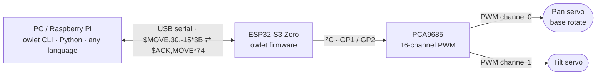
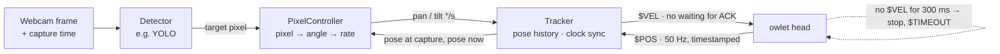
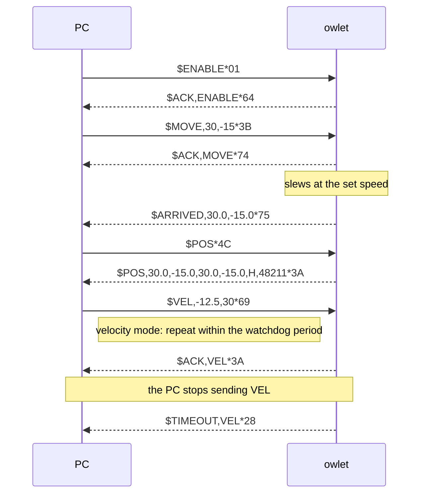
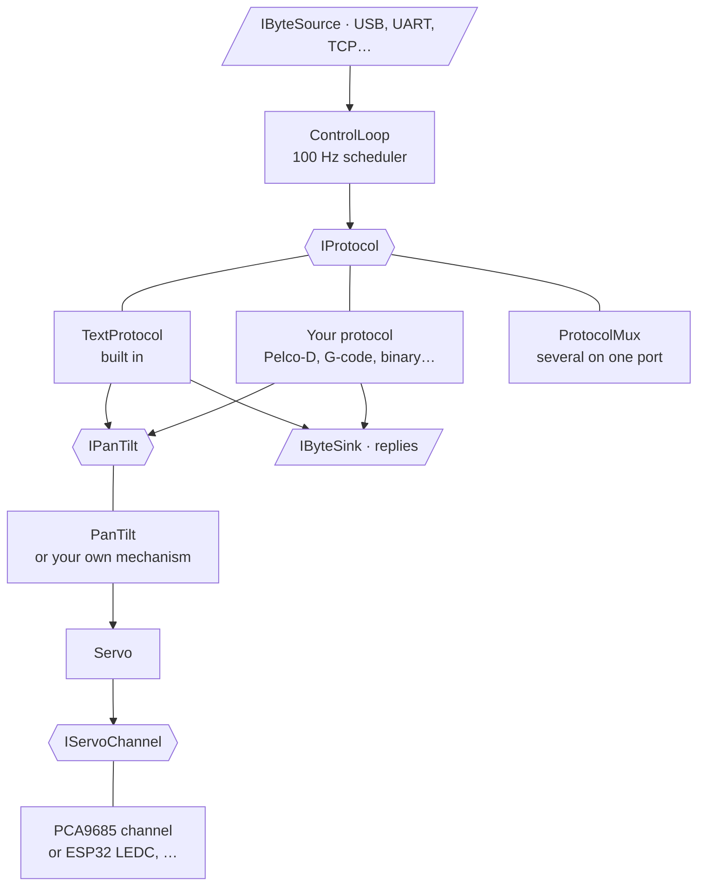

<h1 align="center">🦉 owlet</h1>

<p align="center">
  <b>A USB pan-tilt head you can drive from any computer, in any language, built for camera tracking.</b><br>
  ESP32-S3 · PCA9685 · two 180° servos · one USB cable · a plain-text protocol with checksums
</p>

<p align="center">
  <a href="LICENSE"></a>
  
  
  
  
  
</p>

```console
$ owlet enable
$ owlet move 30 -15 --wait
pan   30.0  tilt  -15.0   target   30.0  -15.0   holding
```

---

## Contents

- [Features](#features)
- [How it works](#how-it-works)
- [Object tracking](#object-tracking)
- [Hardware](#hardware)
- [Quick start](#quick-start)
- [Usage](#usage)
  - [Command-line tool](#command-line-tool)
  - [Python library](#python-library)
  - [Any other language: the wire protocol](#any-other-language-the-wire-protocol)
  - [No hardware? Use the simulator](#no-hardware-use-the-simulator)
- [Protocol reference](#protocol-reference)
- [Extending owlet](#extending-owlet)
- [Using owlet as a git submodule](#using-owlet-as-a-git-submodule)
- [Configuration and calibration](#configuration-and-calibration)
- [Safety](#safety)
- [Building from source](#building-from-source)
- [Project layout](#project-layout)
- [Troubleshooting](#troubleshooting)
- [Project status and roadmap](#project-status-and-roadmap)
- [Contributing](#contributing)
- [License](#license)
- [Acknowledgements](#acknowledgements)

---

## Features

- **Plug in and go.** The ESP32-S3's built-in USB shows up as a standard serial port (`/dev/ttyACM*`, `COMx`, `/dev/cu.usbmodem*`). No drivers, no USB-TTL adapter.
- **Human-readable, checksummed protocol.** One line per message, like `$MOVE,30,-15*3B`. You can type them in a terminal or generate them from any language, and every frame is integrity-checked.
- **Know where it is, and when.** Poll the position with `$POS` or stream it at up to 50 Hz. Every report is timestamped with the device clock, and the client maps those timestamps onto your PC's clock, so you can ask "where was the camera pointing when this frame was taken?"
- **Self-describing.** The head reports its capabilities (`$CAPS`) and its calibration (`$CAL`), so clients adapt instead of probing. Calibrate once from the PC; it's stored on the device and survives power cycles and reflashing.
- **Made for tracking.** Velocity mode (`$VEL`) turns at the rates your controller asks for, and a **watchdog** stops the head if your program stops talking to it. A ready-made `Tracker` and pixel-to-rate controller plug straight into a YOLO/OpenCV loop.
- **Smooth, speed-limited motion.** Constant-velocity slew from 1 to 500 °/s, timed from the actual elapsed time so it doesn't speed up or slow down with loop timing.
- **Safe by default.** The servos are limp at power-up and nothing moves until you explicitly enable it.
- **Pluggable protocols (SOLID).** The firmware core knows nothing about any wire format. Protocols are `IProtocol` plug-ins injected at start-up, several can share the USB port, and you can add your own (Pelco-D, G-code, binary, …) without touching owlet's code.
- **Submodule-friendly.** CMake `owlet::` targets, an ESP-IDF component list, and a `pip`-installable client.
- **Batteries-included PC side.** A `pip`-installable Python library and an `owlet` command with port auto-detection, a live position view, and an interactive shell.
- **Hardware-free development.** A host simulator runs the *real* firmware logic behind a virtual serial port.
- **Efficient.** No heap, no exceptions, fixed buffers, integer formatting, and input handed to protocols a chunk at a time. The whole firmware is about 230 KB.
- **Tested.** 319 automated tests: 242 C++ unit and integration tests, plus 77 Python tests, including end-to-end runs against the simulator. Every finding from an adversarial review has a regression test.

## How it works



The firmware runs a 100 Hz loop. Each pass it advances both servos (position slew or velocity mode, plus the watchdog), lets the protocol emit time-driven messages (arrival, streamed position, timeouts), then reads and answers any complete command lines from USB. All of that logic is platform-independent C++ that is unit-tested on a normal PC. The ESP32-specific code only connects it to the real USB port, clock and I²C bus.

## Object tracking

owlet is designed to be the motion half of a camera tracker: the PC runs the detector, and owlet turns the camera.



```python
import time
from owlet import Owlet, PixelController, Tracker

ctl = PixelController(fov_h_deg=70, fov_v_deg=43, gain=3.0)    # your camera's field of view

with Owlet() as head:
    head.enable()
    with Tracker(head, stream_hz=50, watchdog_ms=300) as tr:   # syncs clocks, streams pose
        while True:
            frame, t_capture = grab_frame()                     # t_capture = time.monotonic()
            target = detect(frame)                              # e.g. YOLO → pixel centre
            if target is None:
                tr.set_rates(0, 0)
                continue
            pan, tilt = ctl.update(target.x, target.y, frame.width, frame.height,
                                   pose_at_capture=tr.pose_at(t_capture),
                                   pose_now=tr.pose_at(time.monotonic()))
            tr.set_rates(pan, tilt)                             # $VEL, no waiting for the ACK
```

| Piece | What it does |
|-------|--------------|
| `$VEL,<pan>,<tilt>` | Turn at signed rates (°/s). A new command replaces the old one immediately; nothing queues. |
| Watchdog (`$WATCHDOG`) | If no `VEL` arrives within the timeout (default 500 ms), the head stops by itself and reports `$TIMEOUT,VEL`. A crashed tracker can't leave the head spinning. |
| Timestamped `$POS` | Each streamed pose carries the device time it was computed. |
| `Tracker` | Background reader that syncs the device clock (minimum round-trip `$CLOCK` sample, refreshed every 5 s), keeps a pose history and sends rates fire-and-forget. If the link breaks or the device reboots, `tr.failed` is set, `tr.last_error` says why, and `set_rates()` raises rather than failing silently. |
| `PixelController` | Pixel offset → angle (pinhole geometry) → rate (gain, deadband, rate limit). Given the pose at capture and the pose now, it subtracts the motion that happened while the detector was running. |

A complete webcam + YOLO script is in [`tools/python/examples/track_object.py`](tools/python/examples/track_object.py):

```bash
pip install ./tools/python opencv-python ultralytics
python tools/python/examples/track_object.py --target person --fov-h 70 --fov-v 43 --show
```

## Hardware

### Bill of materials

| Qty | Part | Notes |
|----:|------|-------|
| 1 | [Waveshare ESP32-S3 Zero](https://www.waveshare.com/wiki/ESP32-S3-Zero) | Any ESP32-S3 board with native USB should work if you adjust the pins |
| 1 | PCA9685 16-channel PWM board | The common blue breakout, I²C address `0x40` |
| 2 | 180° hobby servos (MG90S/SG90 class) | Channel 0 = pan (base rotate), channel 1 = tilt |
| 1 | Pan-tilt bracket / printed mechanism | |
| 1 | USB-C data cable | |
| — | *Optional:* separate 5 V supply for servos | Recommended once the head carries a load |
| — | *Optional:* USB-TTL adapter | Only for reading firmware debug logs |

### Wiring


> **Power note:** two small servos can run off the ESP's USB 5 V for bench testing. Under load, or if the board resets when the servos move (a brown-out), power `V+` from a separate 5 V supply and keep the grounds connected.

## Quick start

### 1. Flash the firmware

You need [Nix](https://nixos.org/download) with [flakes enabled](https://nixos.wiki/wiki/Flakes). It provides ESP-IDF, the compilers and Python, so nothing else needs to be installed.

```bash
git clone https://github.com/Mrunmoy/owlet.git
cd owlet
nix develop                 # first run downloads the toolchain; later runs are instant
./build.py --esp --flash    # build and flash; the board's port is detected automatically
```

With more than one Espressif board connected, pass the port: `./build.py --esp --flash /dev/ttyACM1`.

### 2. The PC client

**In `nix develop`: nothing to install.** The shell already puts the `owlet` command on your `PATH` (it runs the checkout's `tools/bin/owlet`). Don't `pip install` inside the Nix shell: its Python lives in the read-only Nix store, so pip fails with *Permission denied*.

**Not using Nix?** Any machine with Python 3.9+ (Linux, macOS or Windows):

```bash
pip install ./tools/python
```

### 3. Say hello

```bash
owlet ping                  # owlet 0.3.0 (protocol v3) on /dev/ttyACM1
owlet enable                # servos energise at center (0, 0)
owlet move 20 0 --wait      # base turns 20° and the command waits until it's there
owlet pos                   # where is it?
owlet disable               # servos go limp
```

The servos boot **limp**, so `enable` is always the first step. See [Safety](#safety).

## Usage

### Command-line tool

```text
owlet [-p PORT] [-t TIMEOUT] <command> [args]
```

| Command | What it does |
|---------|--------------|
| `owlet ports` | List connected boards that look like an owlet |
| `owlet ping` | Check the link; print firmware and protocol versions |
| `owlet enable [PAN TILT]` | Energise the servos, optionally at a given pose |
| `owlet disable` | Turn the servos off (limp) |
| `owlet move PAN TILT [-w]` | Absolute move in degrees; `-w` waits for arrival |
| `owlet nudge DPAN DTILT [-w]` | Relative move, clamped to the limits |
| `owlet home [-w]` | Move to 0, 0 |
| `owlet stop` | Stop where it is right now |
| `owlet speed [DEG_PER_S]` | Get or set the slew speed (1–500 °/s, default 90) |
| `owlet pos` | Print the current and target position |
| `owlet limits` | Print the soft limits per axis |
| `owlet vel PAN TILT` | Velocity mode in °/s (stops after the watchdog period unless repeated) |
| `owlet watchdog [MS]` | Get or set the velocity watchdog (0 = off, 50–5000 ms) |
| `owlet clock` | Device clock in ms |
| `owlet caps` | What the head can do: speed, velocity, watchdog and stream ranges |
| `owlet cal [pan\|tilt]` | Show the calibration stored on the device |
| `owlet cal pan --limits -85 90` | Change soft limits (works while enabled) |
| `owlet cal tilt --reverse` | Flip an axis's direction (servos must be disabled) |
| `owlet cal tilt --pulses 550 1480 2420` | Set pulse endpoints (servos must be disabled) |
| `owlet cal save` / `owlet cal reset` | Store the calibration in flash / restore factory values |
| `owlet watch [--hz N]` | Live position stream until Ctrl-C |
| `owlet shell` | Interactive prompt: type `move 30 -15`, `speed 45`, `pos`, … |

The port is auto-detected by Espressif's USB vendor ID. Use `-p /dev/ttyACM1`, `-p COM5`, etc. to choose one explicitly.

### Python library

```python
from owlet import Owlet, OwletError

with Owlet() as head:                       # or Owlet("/dev/ttyACM1"), Owlet("COM5")
    head.enable()
    head.speed(60)                          # °/s

    head.move(45, 10, wait=True)            # blocks until $ARRIVED
    print(head.position())                  # Position(pan=45.0, tilt=10.0, ..., state='H', t_ms=...)

    for p in head.watch(hz=20):             # live stream; streaming stops when you break
        print(p.pan, p.tilt, p.moving)
        if not p.moving:
            break

    try:
        head.move(120, 0)                   # outside ±90°
    except OwletError as e:
        print(e.code)                       # "RNG"

    head.disable()
```

The only dependency is [`pyserial`](https://pypi.org/project/pyserial/).

### Any other language: the wire protocol

Every message is one ASCII line:

```
$<NAME>[,<field>...]*<CHECKSUM>\r\n
```

The checksum is the **XOR of every character between `$` and `*`**, written as two hex digits. Here it is in a few languages:

```python
cs = 0
for c in body: cs ^= ord(c)          # body = "MOVE,30,-15"  →  0x3B
```
```c
uint8_t cs = 0; for (const char* p = body; *p; ++p) cs ^= (uint8_t)*p;
```
```javascript
const cs = [...body].reduce((a, c) => a ^ c.charCodeAt(0), 0);
```

An example session:



Serial settings don't matter on native USB (any baud rate works). Open the port normally and **don't toggle DTR/RTS**, because that's the chip's auto-reset signal.

[`docs/protocol_vectors.txt`](docs/protocol_vectors.txt) lists valid and invalid frames you can use to test your own implementation.

### No hardware? Use the simulator

`owlet_sim` runs the real firmware logic (protocol, motion and a simulated PCA9685) behind a Linux pseudo-terminal:

```bash
nix develop
./build.py --host
build/host/apps/host-sim/owlet_sim --link /tmp/owlet &

owlet -p /tmp/owlet enable
owlet -p /tmp/owlet move 20 20 --wait
owlet -p /tmp/owlet watch
```

## Protocol reference

### Requests

| Request | Reply | Notes |
|---------|-------|-------|
| `$PING` | `$PONG,<proto>,<fw>` | e.g. `$PONG,3,0.3.0` |
| `$ENABLE` | `$ACK,ENABLE` | Energise at the last known position (0, 0 after boot) |
| `$ENABLE,<pan>,<tilt>` | `$ACK,ENABLE` | Energise at a pose; if already enabled, moves there smoothly instead |
| `$DISABLE` | `$ACK,DISABLE` | Servos limp |
| `$MOVE,<pan>,<tilt>` | `$ACK,MOVE` | Absolute move; outside the limits → `NAK RNG` |
| `$NUDGE,<dpan>,<dtilt>` | `$ACK,NUDGE` | Relative to the current target; clamped to the limits |
| `$HOME` | `$ACK,HOME` | Same as `MOVE,0,0` |
| `$STOP` | `$ACK,STOP` | Stop at the current position |
| `$SPEED` | `$SPEED,<°/s>` | Query the slew speed |
| `$SPEED,<°/s>` | `$ACK,SPEED` | 1–500, applies to both axes |
| `$POS` | `$POS,<pan>,<tilt>,<tpan>,<ttilt>,<state>,<ms>` | `state`: `D` disabled, `M` moving, `H` holding; `ms`: device time of the pose |
| `$STREAM,<hz>` | `$ACK,STREAM` | 0 = off, 1–50 Hz periodic `$POS` |
| `$LIMITS` | `$LIMITS,<pmin>,<pmax>,<tmin>,<tmax>` | Soft limits in degrees |
| `$VEL,<pan°/s>,<tilt°/s>` | `$ACK,VEL` | Velocity mode, each −500…500; stops at soft limits; ended by any position command |
| `$WATCHDOG` / `$WATCHDOG,<ms>` | `$WATCHDOG,<ms>` / `$ACK,WATCHDOG` | Velocity watchdog: 0 = off, 50–5000 ms, default 500 |
| `$CLOCK` | `$CLOCK,<ms>` | Device uptime in ms (wraps after ~49.7 days) |
| `$CAPS` | `$CAPS,<spdmin>,<spdmax>,<velmax>,<wdmin>,<wdmax>,<hzmax>` | Capabilities, e.g. `$CAPS,1.0,500.0,500.0,50,5000,50` |
| `$CAL,<AXIS>` | `$CAL,<AXIS>,<min_us>,<ctr_us>,<max_us>,<min°>,<max°>,<R\|N>,<F\|S\|M>` | Calibration of `PAN`/`TILT`: reversed or not; factory / saved / modified |
| `$CAL,<AXIS>,<min_us>,<ctr_us>,<max_us>,<min°>,<max°>` | `$ACK,CAL` | Set it. Pulse changes need the servos disabled (`NAK,CAL,ENA`); limits can change any time |
| `$CAL,SAVE` / `$CAL,RESET` | `$ACK,CAL` | Persist to flash / restore factory values and erase (reset needs disabled) |

Angles are degrees from center: **pan + = right, tilt + = up**. Numbers may have an optional sign and up to 2 decimal places. `MOVE`, `NUDGE`, `HOME`, `STOP` and `VEL` are refused with `NAK …,DIS` until the head is enabled. This is protocol **v3** (owlet 0.3.0); clients should check the version in `$PONG`.

### Messages owlet sends on its own

| Message | When |
|---------|------|
| `$READY,<proto>,<fw>` | Once after boot |
| `$ARRIVED,<pan>,<tilt>` | Exactly once for every accepted `MOVE`/`NUDGE`/`HOME` (cancelled by `STOP`/`DISABLE`) |
| `$POS,…` | At the `STREAM` rate |
| `$ERR,BUS` | A servo update failed to reach the PCA9685 |
| `$TIMEOUT,VEL` | The velocity watchdog stopped the head |

### Errors

| Reply | Meaning |
|-------|---------|
| `$NAK,<CMD>,FMT` | Wrong number of fields or a malformed number |
| `$NAK,<CMD>,RNG` | Value out of range |
| `$NAK,<CMD>,DIS` | Servos are disabled; send `ENABLE` first |
| `$NAK,<CMD>,BUS` | PCA9685 didn't respond (check wiring and power) |
| `$NAK,CAL,ENA` | Pulse calibration can only change while the servos are disabled |
| `$NAK,CAL,STO` | Saving to (or erasing from) flash failed |
| `$ERR,CHK` | Checksum mismatch |
| `$ERR,SYN` | Not a valid `$…*HH` frame |
| `$ERR,LEN` | Line longer than 82 bytes |
| `$ERR,UNK` | Unknown command |

Every valid request gets exactly one reply, in order. The full specification, including edge cases and the reasoning behind them, is in [`docs/DESIGN.md` §5](docs/DESIGN.md#5-wire-protocol-v1).

> **About "position":** hobby servos don't report where they actually are. owlet reports the position it has *commanded*, rate-limited the same way the servo moves. At normal speeds the real servo follows it closely. If a servo is blocked or overloaded, the two will differ.

## Extending owlet

The firmware is organised around small interfaces, so you can extend it by **adding** classes rather than editing existing ones:



| Interface | Implement it to… |
|-----------|-------------------|
| `owlet::core::IProtocol` | add a wire protocol (Pelco-D for PTZ software, G-code, a compact binary format, …) |
| `owlet::core::IPanTilt` | drive a different mechanism (steppers, another servo controller) under every existing protocol |
| `owlet::hal::IServoChannel` | output servo pulses from something other than a PCA9685 (e.g. ESP32 LEDC) |
| `owlet::hal::IByteSource` / `IByteSink` | carry the protocol over another transport (UART, TCP, BLE) |

A protocol is about 100 lines. It only ever sees `IPanTilt` (what it may ask the head to do) and `IByteSink` (where replies go):

```cpp
class MyProtocol final : public owlet::core::IProtocol {
public:
    MyProtocol(owlet::hal::IByteSink& out, owlet::core::IPanTilt& head);
    bool claims(uint8_t byte, bool atLineStart) const override;   // e.g. byte == 0xFF
    owlet::core::ConsumeResult consume(const uint8_t* data, std::size_t len) override;
    void begin(uint32_t nowMs) override;
    void onTick(uint32_t nowMs, const owlet::core::TickStatus& status) override;
};
```

Then, in `apps/esp32-owlet/main/main.cpp`, run it next to the built-in protocol on the same USB port:

```cpp
static owlet::text::TextProtocol    native(usb, head, clock, owlet::core::kFirmwareVersion);
static MyProtocol                   mine(usb, head);
static owlet::core::ProtocolMux<2>  protocols({&native, &mine});
static owlet::core::ControlLoop     loop(usb, head, protocols);
```

The multiplexer offers the first byte of each frame to each protocol in order. Native frames start with `$`, so anything else is free for your protocol. The contract and an example test setup are in [`docs/DESIGN.md` §4.3–4.4](docs/DESIGN.md#43-the-iprotocol-contract).

## Using owlet as a git submodule

```bash
git submodule add https://github.com/Mrunmoy/owlet.git third_party/owlet
```

- **Python (PC side):** `pip install -e third_party/owlet/tools/python`, then `from owlet import Owlet, Tracker, PixelController`.
- **Host C++ (tests, simulators):** `add_subdirectory(third_party/owlet)` and link `owlet::core`, `owlet::text`, `owlet::servo`, `owlet::pca9685` or `owlet::hal`. owlet's own tests and tools are built only when it's the top-level project.
- **ESP-IDF firmware:** in your project's `CMakeLists.txt`:

  ```cmake
  include(${CMAKE_CURRENT_LIST_DIR}/third_party/owlet/cmake/owlet-idf-components.cmake)
  list(APPEND EXTRA_COMPONENT_DIRS ${OWLET_IDF_COMPONENT_DIRS})
  ```

  then `REQUIRES owlet_core owlet_text owlet_pca9685 owlet_esp32` in your `main` component, and wire things up as `apps/esp32-owlet/main/main.cpp` does.

  **Copy the console settings too.** The USB port must carry only protocol traffic, so add these to your project's `sdkconfig.defaults` (see `apps/esp32-owlet/sdkconfig.defaults`). Without them, ESP-IDF log lines are mixed into protocol frames.

  ```
  CONFIG_ESP_CONSOLE_UART_DEFAULT=y
  CONFIG_ESP_CONSOLE_SECONDARY_NONE=y
  ```

## Configuration and calibration

Calibration lives **on the device**, in flash. Every client can read it (`$CAL`, `$LIMITS`, `$CAPS`), and changing it never needs a rebuild:

```bash
owlet cal                                  # show both axes
owlet disable                              # pulse changes need the servos limp
owlet cal tilt --reverse                   # this tilt servo is mounted mirrored
owlet cal pan --limits -85 90              # keep pan off its left end stop
owlet cal save                             # store it; survives power cycles and reflashing
```

```
pan   pulses 500/1500/2500 us   limits -85.0..90.0 deg   normal     (saved)
tilt  pulses 2500/1500/500 us   limits -90.0..90.0 deg   reversed   (saved)
```

| Per axis | Meaning | Factory default |
|----------|---------|-----------------|
| pulses `min/center/max` | Pulse width (µs) at −90° / 0° / +90°. Swap min and max to reverse the axis. | 500 / 1500 / 2500 |
| limits `min..max` | Soft limits in degrees. Commands outside them are refused (`MOVE`) or clamped (`NUDGE`, velocity mode). | −90 .. 90 |

- **Axis moves the wrong way?** Run `owlet cal <axis> --reverse` with the servos disabled.
- **Mechanism collides before ±90°?** Narrow the limits. This works even while enabled, and the head backs away inside the new limits.
- **0° isn't quite centred?** Adjust the centre pulse (`--pulses`). The mapping bends at the centre, so the endpoints don't move.
- `owlet cal reset` goes back to the factory values. Those come from Kconfig (`idf.py menuconfig` → **owlet configuration**), along with the I²C pins and PCA9685 channels.

Many servos reach their physical end stop before 500 or 2500 µs. The step-by-step procedure is in [`docs/CALIBRATION.md`](docs/CALIBRATION.md).

### Mounting the servo horns

1. Power the board and run `owlet enable 0 0`. Both servos will hold at center.
2. Fit the horns so the head faces straight ahead and level. Don't twist the shafts by hand while they're energised.
3. Run `owlet disable` when you're done.

## Safety

- **Limp at boot.** Every servo output is off after power-up or reset. Nothing moves until a computer sends `ENABLE`.
- **The first `ENABLE` jumps.** A hobby servo moves to its first commanded position at full speed, because nothing can control its speed before it knows where it is. Use `ENABLE,<pan>,<tilt>` with the pose the head is actually in to keep that jump small.
- **No silent queuing.** Move commands sent while disabled are refused, not saved for later, so enabling never triggers an unexpected motion.
- **Soft limits** are enforced in firmware. Set them inside your mechanism's hard stops.

## Building from source

Everything below runs inside `nix develop`.

```bash
./build.py --host -t          # host build + all tests (C++ and Python)
./build.py --host --clean -t  # same, from scratch
./build.py --esp              # firmware only
./build.py --esp --flash      # firmware + flash
```

Run one test suite or test:

```bash
ctest --test-dir build/host -R TextProtocol --output-on-failure
build/host/tests/owlet_servo_test --gtest_filter='Servo.Slew*'
cd tools/python && python -m unittest tests.test_protocol
```

> Nix flakes only see files that git knows about. If you add a file and the build can't find it, run `git add` on it first.

**Without Nix:** `apps/esp32-owlet` is a standard ESP-IDF v5.5 project, so with ESP-IDF installed natively, `cd apps/esp32-owlet && idf.py build flash` should work. This path isn't regularly tested. The host tests only need CMake, Ninja and a C++17 compiler (GoogleTest is downloaded automatically).

### Debug logs

The USB port carries **only** protocol traffic. Firmware logs go to UART0: connect a USB-TTL adapter's RX to **GP43** (and GND), then open it at 115200 baud.

## Project layout

| Path | What's there |
|------|--------------|
| `apps/esp32-owlet/` | ESP-IDF firmware project: entry point and Kconfig |
| `apps/host-sim/` | `owlet_sim`: the firmware core on a Linux pseudo-terminal |
| `drivers/owlet_hal/` | Hardware interfaces: I²C, delay, servo channel, serial port, clock |
| `drivers/owlet_pca9685/` | PCA9685 PWM driver |
| `drivers/owlet_servo/` | Servo model: angle ↔ pulse, speed-limited motion |
| `firmware/common/owlet_core/` | Interfaces (`IPanTilt`, `IProtocol`, `ICalibration`), `PanTilt`, `ControlLoop`, `ProtocolMux`, `Calibrator` |
| `firmware/common/owlet_text/` | The native text protocol: codec + `TextProtocol` |
| `platform/owlet_esp32/` | ESP-IDF implementations of the hardware interfaces, NVS calibration store |
| `simulators/` | Virtual I²C bus + register-level PCA9685 model |
| `tests/` | GoogleTest suites |
| `tools/python/` | Client library and `owlet` CLI (`tools/bin/owlet` runs it in `nix develop`) |
| `docs/` | Design, calibration, dev journal, protocol test vectors |
| `build.py` · `flake.nix` | Build/test/flash entry point · reproducible toolchain |

Code in `drivers/` and `firmware/common/` is plain C++17 with no ESP-IDF headers and no dynamic memory, and it builds and runs on a PC. Only `platform/` and `apps/esp32-owlet/` touch ESP-IDF. Read [`docs/DESIGN.md`](docs/DESIGN.md) for the architecture and the reasoning behind it.

## Troubleshooting

| Symptom | Likely cause and fix |
|---------|-------------------|
| `could not auto-detect the owlet port` | No board, or several boards, found. Run `owlet ports`, then pass `-p PORT`. |
| `Permission denied: '/dev/ttyACM…'` (Linux) | Add yourself to the group that owns the device (`ls -l /dev/ttyACM*`, usually `dialout` or `plugdev`), then log out and back in. |
| `no answer from owlet` | Wrong port, firmware not flashed, or something else (e.g. a serial monitor) has the port open. |
| `MOVE refused: DIS` | Servos are disabled. Run `owlet enable` first. |
| `ENABLE refused: BUS` | The PCA9685 isn't answering. Check SDA/SCL (GP1/GP2), 3V3 to `VCC`, and the common GND. |
| Board resets when the servos move | 5 V brown-out. Power the servos (`V+`) from a separate supply. |
| An axis moves the wrong way | Swap that axis's min/max pulse ([Configuration](#configuration-and-calibration)). |
| Servo buzzes at the ends of travel | It's pressing on its end stop. Calibrate the endpoints or narrow the limits. |

## Project status and roadmap

**v0.3.0, alpha.** The firmware, protocol, PC client, tracking support, on-device calibration and simulator are complete and tested. Motion, directions and ranges have been verified on the reference head. Velocity mode and the watchdog are verified in the simulator but not yet on hardware.

- [x] Firmware: USB protocol, speed-limited motion, boot-limp safety
- [x] Python library and CLI with port auto-detection
- [x] Host simulator and end-to-end tests
- [x] First motion on hardware
- [x] Pluggable protocol architecture (`IProtocol`, `ProtocolMux`)
- [x] Tracking support: velocity mode, watchdog, timestamped pose, clock sync, `Tracker`, `PixelController`
- [x] On-device calibration and capabilities (`$CAL`, `$CAPS`)
- [ ] Verify velocity mode and watchdog on hardware
- [ ] Track a real object with the webcam + YOLO example
- [ ] Servo calibration for the reference mechanism ([`docs/CALIBRATION.md`](docs/CALIBRATION.md))
- [ ] Verify the client on Windows and macOS
- [ ] Separate speed per axis
- [ ] Mechanical design files for the pan-tilt bracket

Progress, decisions and test evidence are logged in [`docs/DEV_JOURNAL.md`](docs/DEV_JOURNAL.md).

## Contributing

Issues and pull requests are welcome. Before opening a PR:

1. Run `./build.py --host -t`; every test must pass.
2. Add or update tests for any behaviour you change. All device behaviour lives in `firmware/common/` so it can be tested on a PC.
3. If you change the native protocol, update the firmware (`owlet_text`), the Python client, and `docs/DESIGN.md` §5 together.
4. Keep firmware code free of dynamic allocation, exceptions and RTTI, following the existing style (C++17, Allman braces, `m_` member prefix).

## License

owlet is released under the [MIT License](LICENSE).

## Acknowledgements

- owlet grew out of **clops**, a one-eyed robot built on the same ESP32-S3 + PCA9685 stack. Its HAL, PCA9685 driver and simulator were carried over.
- Toolchain packaging by [nixpkgs-esp-dev](https://github.com/mirrexagon/nixpkgs-esp-dev).
