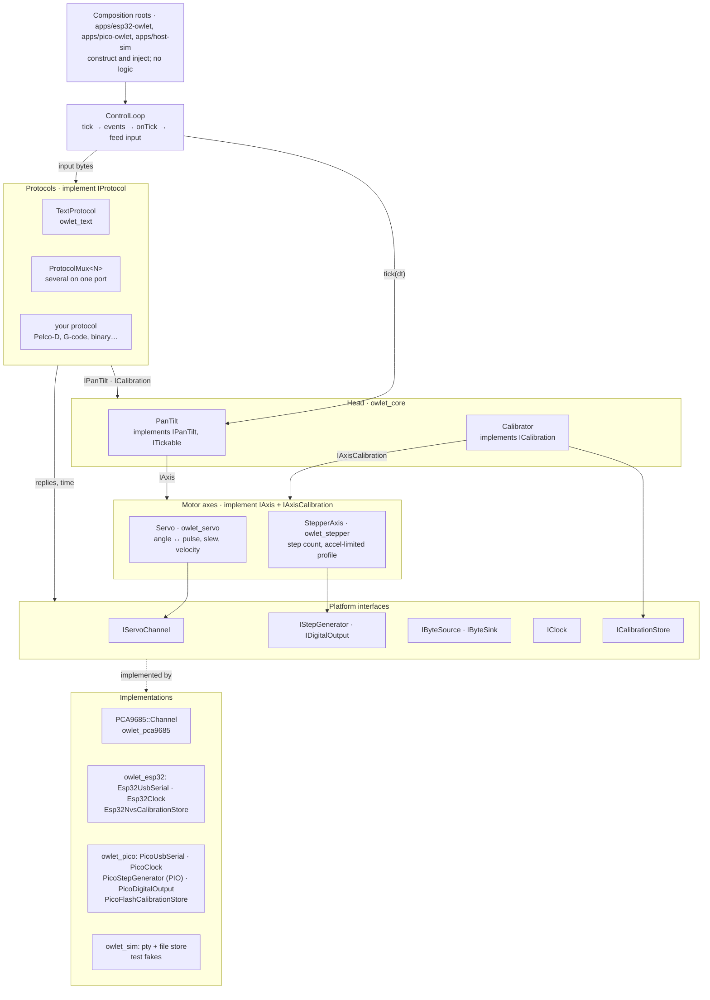

# owlet — Design Document

*Last updated: 2026-10-19*

## 1. Goals

- A two-axis **pan-tilt head** that any PC can drive over a single USB cable.
- A **documented, human-readable wire protocol** with integrity checking, so it can be scripted from any language or typed by hand.
- The PC can **command a pose** and **know the current pose** at any time, either by polling or by streaming.
- Reuse the proven pieces from clops, the author's one-eyed robot: the HAL interfaces, PCA9685 driver, simulators and build system.
- Keep **all behaviour host-testable**. On clops the real behaviour lived in an ESP-only `main.cpp` with no tests; owlet keeps `main.cpp` as pure wiring.

## 2. Non-goals

- No WiFi / BLE / web UI in the shipped apps. The USB CDC link is the only control surface, but it reaches the core as `IByteSource`/`IByteSink`, so another transport is an added class (§4.7).
- No closed-loop position feedback (hobby servos don't report position and the stepper head has no encoder; see §6.4).
- No trajectory planning beyond a constant-velocity slew per axis (servo) or a trapezoidal speed profile per axis (stepper).

## 3. Hardware

Two reference heads share everything above the motor and platform seams. §3.1 and §3.2 describe the servo head, §3.3 the stepper head.

| Component                | Details                                                    |
|--------------------------|------------------------------------------------------------|
| MCU                      | Waveshare ESP32-S3 Zero (native USB on the USB-C connector) |
| Servo controller         | PCA9685, I2C address 0x40, 50 Hz                           |
| Actuators                | 2× 180° hobby servos (MG90S-class): ±90° from center       |
| Power                    | ESP USB-C 5 V → PCA9685 V+ (bench); separate 5 V supply recommended for loaded heads |

### 3.1 Pin map

| ESP32-S3 Zero | PCA9685 / other | Function                              |
|---------------|-----------------|---------------------------------------|
| `GND`         | `GND`           | common ground                         |
| `3V3`         | `VCC`           | logic supply                          |
| `5V`          | `V+`            | servo rail                            |
| `GP1`         | `SDA`           | I2C data                              |
| `GP2`         | `SCL`           | I2C clock                             |
| USB-C         | PC              | **protocol** (USB-Serial-JTAG, CDC-ACM) |
| `GP43` (TX0)  | optional USB-TTL RX | debug log console (UART0, 115200)  |

PCA9685 channels: **0 = pan**, **1 = tilt**.

### 3.2 Why the logs move off USB

On the ESP32-S3 the USB-C port is the USB-Serial-JTAG peripheral, which enumerates as a standard CDC-ACM serial port (`/dev/ttyACM*` on Linux, `COMx` on Windows, `/dev/cu.usbmodem*` on macOS). No driver or adapter is needed. By default ESP-IDF sends its log console to this port, which would interleave `I (123) ...` lines with protocol frames. owlet points the primary console at UART0 (GP43/GP44) and disables the secondary console, so the USB port carries only protocol traffic. If you want logs, attach a USB-TTL adapter to GP43.

The ROM bootloader still prints a short banner on USB at reset. The protocol framer ignores everything that doesn't start with `$`, and the firmware announces itself with `$READY` once it is ready, so clients should wait for that.

### 3.3 Stepper head (Raspberry Pi Pico)

| Component | Details |
|-----------|---------|
| MCU | Raspberry Pi Pico or pin-compatible RP2040 board (native USB, CDC-ACM through the pico-sdk) |
| Drivers | 2× TMC2209 StepStick, step/dir for motion, 1/16 microstepping. Current and microsteps are set over each driver's UART (§5.7); without the link a driver runs standalone from the MS pins and its potentiometer |
| Actuators | 2× NEMA 17 pancake steppers (200 steps/rev), each through a 20T:60T GT2 belt (3:1) |
| Resolution | 200 × 16 × 3 = 9600 microsteps per output revolution: 0.0375° per step |
| Power | Pico from USB; 12 V to the drivers' `VM` only |

| Pico | Goes to | Function |
|------|---------|----------|
| `GP2`, `GP3` | pan driver `STEP`, `DIR` | PIO state machine 0 |
| `GP6`, `GP7` | tilt driver `DIR`, `STEP` | PIO state machine 1 (as built: the reverse of the pan pair) |
| `GP8` | `EN` on both drivers | active low; high (off) from reset until `ENABLE` |
| `GP12`, `GP13` | `MS1`, `MS2` on both drivers | microstep select |
| `GP4` + `GP5` | `PDN/UART` on the pan driver | TMC2209 UART (TX + RX on one line): current, microsteps, status |
| `GP0` + `GP1` | `PDN/UART` on the tilt driver | as above; a private line per driver, so no addressing is needed |
| `GP25` | the LED on the board | heartbeat: one short flash a second while the control loop runs |
| `GP22` | `3V3` → resistor → LED → `GP22` | the pin sinks the LED (low = lit) while the head is moving |
| `3V3(OUT)` | `VIO` on both drivers | logic supply |
| USB | PC | **protocol** only (no console anywhere) |

The tilt pair is deliberately not `STEP`, `DIR` in pin order: that is how the reference head was wired, and the firmware follows the hardware.

`GP10`/`GP11` (pan) and `GP14`/`GP15` (tilt) are set aside for the limit switches, two per axis. The drawing and the driver pinout are in [`wiring/pico-tmc2209/`](wiring/pico-tmc2209/README.md); the printable mechanism is in [`../mechanical/stepper-head/`](../mechanical/stepper-head/). The pin map and the motion limits are in `apps/pico-owlet/board.hpp`, the one file that describes this head.

## 4. Software architecture

### 4.1 Layers and interfaces



Solid arrows mean "uses"; the dotted arrow leads to the implementations of the platform interfaces. Protocols depend only on interfaces (`IPanTilt`, `ICalibration`, `IByteSink`, `IClock`), never on a concrete head or platform. `owlet_core` depends on `owlet_hal` alone: it links against no motor driver, so it cannot tell a servo from a stepper. (`ICalibrationStore` is declared in `owlet_core`; the others are in `owlet_hal`.)

There are three places to swap something, and each is one class or one folder:

| To change… | Write… | Nothing else changes in… |
|------------|--------|--------------------------|
| the **motor type** | an `IAxis` + `IAxisCalibration` class in `drivers/` | core, protocols, platforms, client |
| the **board** | a `platform/owlet_<board>/` folder and a wiring-only `main.cpp` | core, protocols, drivers, client |
| the **transport** | an `IByteSource` + `IByteSink` class | everything else |

| Interface | Owner | Role |
|-----------|-------|------|
| `hal::IByteSource` / `hal::IByteSink` | `owlet_hal` | Input and output halves of a byte stream. `ISerialPort` combines them. Protocols only receive a sink; the loop only receives a source. |
| `hal::IAxis` | `owlet_hal` | One motor in degrees: engage/release, target, velocity, speed, `tick(dt)`, position, limits and what it can do (`Capabilities`). **The motor seam.** `Servo` and `StepperAxis` implement it. |
| `hal::IAxisCalibration` | `owlet_hal` | The calibration face of an axis: report, validate, apply. What counts as a valid calibration is the axis's business, not the core's (§5.6). |
| `hal::IServoChannel` | `owlet_hal` | One PWM output: the seam for PCA9685, LEDC or anything else. |
| `hal::IStepGenerator` | `owlet_hal` | Step/dir pulses for one driver: "emit N steps evenly over the next T µs". PIO on the Pico. |
| `hal::IDigitalOutput` | `owlet_hal` | One logical output (driver enable, microstep select, LED). Polarity belongs to the platform object. |
| `core::IPanTilt` | `owlet_core` | Everything a protocol may ask of the head: enable/disable, move/nudge/home/stop, speed, pose, limits, state. `PanTilt` implements it over any two `IAxis`. |
| `core::ICalibration` | `owlet_core` | Read, set, save and reset per-axis calibration. Implemented by `Calibrator`, which validates and enforces the enabled/disabled rules. |
| `core::ICalibrationStore` | `owlet_core` | Persistence for calibration (NVS on ESP32, a flash sector on the Pico, a file in the simulator, a fake in tests). |
| `core::ITickable` | `owlet_core` | `tick(dtMs) → TickStatus`: advance motion by elapsed time. Only the loop calls it, never a protocol. |
| `core::EventNotifier` / `core::EventDelegate` | `owlet_core` | Where a change is announced (`notifyArrived()`, `notifyLimitHit(axis, end)`, …) and who reacts to it (`onArrived()`, `onLimitHit(axis, end)`, …). `core::EventBus` carries one to the other (see §4.2 and [design/EVENT_DRIVEN.md](design/EVENT_DRIVEN.md)). Underneath are the untyped `IEventSink` and `IEventObserver`. |
| `core::IProtocol` | `owlet_core` | A wire protocol: `claims()` / `consume()` / `begin()` / `onTick()` (see §4.3). |

The SOLID principles map onto this as follows:

- **Single responsibility:** `ControlLoop` schedules; protocols translate bytes to `IPanTilt` calls; `PanTilt` enforces policy; an axis (`Servo`, `StepperAxis`) maps and shapes motion; drivers talk to silicon.
- **Open/closed:** adding a protocol or a motion backend means adding a class. No existing class changes.
- **Liskov substitution:** every `IProtocol` works standalone *or* inside `ProtocolMux`, every `IPanTilt` works under every protocol, and every `IAxis` works under `PanTilt` (a test drives it with a fake axis that is neither servo nor stepper).
- **Interface segregation:** protocols can't tick motion or read the port; the loop can't issue moves; the motion policy sees `IAxis` and the calibrator sees `IAxisCalibration`, never each other's half.
- **Dependency inversion:** `owlet_core` depends on no protocol and no motor driver. Protocols depend on `IPanTilt`/`IByteSink`, never on `PanTilt` or a platform type.

Rules:

- `drivers/` and `firmware/common/` are C++17 with no vendor headers, no heap, no exceptions and no RTTI. They build on the host for tests.
- `platform/owlet_esp32/` and `apps/esp32-owlet/` are the only places ESP-IDF headers may appear; `platform/owlet_pico/` and `apps/pico-owlet/` the only places for pico-sdk headers.
- The `owlet_` directory prefix keeps ESP-IDF component names (= directory basename) unique.
- Nothing in the core reads a clock or sleeps. Time comes in through `service(nowMs)`, so tests use a fake clock.

### 4.2 Control loop

`ControlLoop::service(nowMs)` runs on one task at a fixed rate chosen by the app: 100 Hz on the servo head (a servo only updates at 50 Hz), 500 Hz on the stepper head (each tick hands the pulse generator one 2 ms burst per axis; see §6.5).

1. `ITickable::tick(dt)` with the **real** elapsed time. `PanTilt` caps each motion step at 100 ms itself, so a starved loop resumes without lurching, while the watchdog still measures wall time.
2. `EventBus::dispatch()` delivers what that step announced (arrival, watchdog, bus fault) to every observer, in the order they were attached. `TextProtocol` is one, and writes `$ARRIVED`, `$TIMEOUT` and `$ERR,BUS` in answer.
3. `IProtocol::onTick(nowMs)` lets the protocol emit output driven by time alone: the position stream.
4. At most 4 × 64-byte chunks are read from `IByteSource` and handed to `IProtocol::consume()`, so a flood of input can't stall motion or the watchdog. That's 25 KB/s, far beyond what the protocol needs. Replies are written synchronously to the protocol's `IByteSink`.

Motion is ticked before input is read, so a reply is never preceded by an event caused by the request it answers. One task owns all state, so nothing needs a mutex.

### 4.3 The `IProtocol` contract

```cpp
struct ConsumeResult { std::size_t consumed; bool released; };

class IProtocol {
    virtual bool claims(uint8_t byte, bool atLineStart) const = 0;  // may I own the stream from here?
    virtual ConsumeResult consume(const uint8_t* data, std::size_t len) = 0;
    virtual void begin(uint32_t nowMs) = 0;                          // boot banner
    virtual void onTick(uint32_t nowMs) = 0;                         // time-driven output
};
```

- `consume()` returns how many bytes it took and `released = true` at the end of each frame (for line protocols, at CR/LF). It may also return `{0, released}` to mean **"this byte isn't mine"**: the mux offers that byte to the other protocols. `TextProtocol` does this on any non-text byte, so a stray `$` can't lock a binary protocol out, and it releases on overflow. Returning `{0, not released}` is a contract violation; the caller drops the byte.
- `claims()` is only used by `ProtocolMux`. Native frames are claimed on `$` anywhere, so a garbled line resyncs at the next `$`. A line protocol such as G-code would claim only at line start (`atLineStart`), and a binary protocol such as Pelco-D would claim its `0xFF` sync byte anywhere.
- `ProtocolMux<N>` offers each frame's first byte to its protocols in order. The first one that claims it owns the stream until it releases. A byte nobody claims is returned to the caller and dropped. That is how the ROM boot banner is discarded: its bytes are dropped one at a time, except a `$`, which the native protocol claims anywhere. The mux feeds whole chunks to the owner, so each chunk costs one virtual call rather than one per byte.
- "Line start" is true after a CR/LF and at power-up. A nested mux adopts its parent's line-start state (passed through `claims()`), so nested arbitration matches the outer one.
- The mux is itself an `IProtocol` (composite), so a single protocol and a mux are interchangeable at the composition root.

### 4.4 Writing your own protocol

1. Create a component (e.g. `firmware/common/my_proto/`) that depends on `owlet_core` only.
2. Implement `IProtocol`. Take `IPanTilt&` and `IByteSink&` in the constructor.
3. In `apps/esp32-owlet/main/main.cpp` or `apps/pico-owlet/main.cpp`, construct it and add it to the `ProtocolMux` (or pass it to `ControlLoop` directly if it should be the only protocol).
4. Unit-test it on the host with a real `PanTilt` over `FakeServoChannel`, or with your own `IPanTilt` fake. See `tests/test_text_protocol.cpp` for the pattern.

### 4.5 Efficiency

- No dynamic allocation anywhere in firmware code. Every buffer is a fixed `std::array` sized at compile time (frame 80 B, reply line 82 B, read chunk 64 B).
- Virtual dispatch happens once per chunk of input and once per tick per protocol, never per byte inside a protocol.
- Number formatting is integer fixed-point, so neither target nor host uses `printf` float formatting.
- `ProtocolMux<N>` takes its protocol count as a template parameter and stores plain pointers in a `std::array`.

### 4.6 Using owlet as a submodule

- **Host CMake:** `add_subdirectory(owlet)` gives the `owlet::hal`, `owlet::pca9685`, `owlet::servo`, `owlet::stepper`, `owlet::core` and `owlet::text` targets. Tests and the simulator are built only when owlet is the top-level project (`OWLET_BUILD_TESTS` defaults to `PROJECT_IS_TOP_LEVEL`).
- **ESP-IDF:** `include(owlet/cmake/owlet-idf-components.cmake)` and append `${OWLET_IDF_COMPONENT_DIRS}` to `EXTRA_COMPONENT_DIRS`. The bundled app uses this same list.
- **pico-sdk:** `add_subdirectory()` the `drivers`, `firmware/common` and `platform/owlet_pico` directories after `pico_sdk_init()`, as `apps/pico-owlet/CMakeLists.txt` does. The shared components build as ordinary static libraries; `owlet::pico` is an INTERFACE library so it compiles with the application's SDK configuration.
- **Python:** `pip install ./owlet/tools/python`, or `pip install -e` for development.

### 4.7 Porting

**A new motor type** is a class implementing `hal::IAxis` and `hal::IAxisCalibration`, tested on the host against fakes of whatever hardware interface it needs. Construct two in `main.cpp` and pass them to `PanTilt` and `Calibrator`. `tests/mocks/FakeAxis.hpp` is the smallest possible example.

**A new board** is a `platform/owlet_<board>/` folder implementing `IClock`, `ISerialPort` and `ICalibrationStore`, plus the motor-side interface its head uses (`II2CBus` for the PCA9685, or `IStepGenerator` and `IDigitalOutput` for steppers), and an app whose `main.cpp` only constructs and injects. The Pico platform is about 525 lines of `.cpp` (885 with headers) and changed nothing in the protocol or the client. For the full stepper feature set a board also implements `IHalfDuplexLink` (the driver UART), `IDigitalInput` (limit switches) and `IInterruptLock`.

**A new transport** (UART, TCP, BLE) is a class implementing `IByteSource` and `IByteSink`. Give its source half to `ControlLoop` and its sink half to the protocol. To serve two links at once, run a loop per link or merge them behind one `ISerialPort`.

What the platform must get right for the rest to behave: a monotonic millisecond clock, a non-blocking `read()`, a `write()` that returns promptly even when the host has stopped listening, and a loop that calls `service()` at a steady rate.

## 5. Native wire protocol (v3)

This is owlet's built-in protocol. It is designed for **closed-loop control from a PC**, such as camera-based object tracking: commands replace the current goal immediately instead of queuing, velocity mode with a safety watchdog maps directly onto a tracking controller's output, and timestamped position streaming lets the PC know where the head pointed when each camera frame was taken. Other protocols can be added as plug-ins (§4.4).

Version 2 (owlet 0.2.0) added `VEL`, `WATCHDOG`, `CLOCK`, `$TIMEOUT`, and the timestamp field on `$POS`. Version 3 (owlet 0.3.0) added `CAPS` and `CAL` (§5.6). Later firmware added commands without changing the protocol version: 0.4.0 added `DIAG` (§5.7); 0.5.0 added `$EVT`, `EVENTS`, `STAT` (§5.8), `DTC` (§5.9) and `SEEK` (§6.6). Clients must check the version in `$PONG`, and treat `$ERR,UNK` as "this firmware does not have that command".

### 5.1 Framing

```
$<BODY>*<CK>\r\n
```

- `BODY` = `NAME[,field]*`. `NAME` is upper-case ASCII letters. Fields are printable ASCII excluding `$`, `*` and `,`.
- `CK` = XOR of every byte of `BODY` (between `$` and `*`, both excluded), as two hex digits. The device always emits upper-case; it accepts either case.
- The line ends with `\n`, and a preceding `\r` is optional. The device always sends `\r\n`.
- The maximum frame length is **82 bytes**, including `$` and `\r\n`.
- Bytes outside a frame are ignored. A `$` in the middle of a frame discards the partial frame and starts a new one.
- The checksum is **mandatory** in both directions.

Example: `$MOVE,30,-15*3B\r\n`, where `0x3B` is the XOR of `MOVE,30,-15`.

### 5.2 Numbers

Angles and speeds are decimal with an optional sign and up to 2 fractional digits: `30`, `-15.5`, `+0.25`. Exponents, `nan`, `inf` and empty strings are rejected. The device reports angles with exactly one decimal (`-15.5`, `0.0`).

The coordinate frame is: **pan +** = right, **tilt +** = up, **0,0** = calibrated center (on the stepper head, the pose it was in at enable; the reference rig takes tilt zero as straight up, so there + tilts backwards over the top). Viewed from behind the head, "right" is the head's right. Mounting differences are handled by calibration (an inverted axis swaps min/max pulse), never by the protocol.

### 5.3 Requests (PC → device)

| Request                     | Success reply                         | Notes |
|-----------------------------|---------------------------------------|-------|
| `$PING`                     | `$PONG,<proto>,<fw>`                  | e.g. `$PONG,3,0.5.0` |
| `$ENABLE`                   | `$ACK,ENABLE`                         | Energise both motors at their last known position (initially 0,0). No-op if already enabled. |
| `$ENABLE,<pan>,<tilt>`      | `$ACK,ENABLE`                         | Energise at the given pose (snap). If already enabled, this is a slewed move and earns an `$ARRIVED`. |
| `$DISABLE`                  | `$ACK,DISABLE`                        | Motors off (servo PWM off, stepper drivers disabled); the head goes limp. Target is kept. |
| `$MOVE,<pan>,<tilt>`        | `$ACK,MOVE`                           | Absolute move at the current speed. Out-of-limit → `RNG`. |
| `$NUDGE,<dpan>,<dtilt>`     | `$ACK,NUDGE`                          | Relative to the current **target**, clamped to limits (for jogging). |
| `$HOME`                     | `$ACK,HOME`                           | `MOVE,0,0`. |
| `$STOP`                     | `$ACK,STOP`                           | Target := current position. |
| `$SPEED`                    | `$SPEED,<deg/s>`                      | Query slew speed. |
| `$SPEED,<deg/s>`            | `$ACK,SPEED`                          | Both axes, within the range `$CAPS` reports (servo head 1–500, stepper head 1–240). Default 90. |
| `$POS`                      | `$POS,<pan>,<tilt>,<tpan>,<ttilt>,<st>,<ms>` | See §5.5. |
| `$STREAM,<hz>`              | `$ACK,STREAM`                         | 0 = off, 1–50 Hz periodic `$POS`. |
| `$LIMITS`                   | `$LIMITS,<pmin>,<pmax>,<tmin>,<tmax>` | Soft limits in degrees. |
| `$VEL,<pan°/s>,<tilt°/s>`   | `$ACK,VEL`                            | Velocity mode: turn continuously at these signed rates (each within ± the `$CAPS` velocity maximum: 500 on the servo head, 240 on the stepper head). The head stops at soft limits without error. Replaces any position move (no `$ARRIVED`); any `MOVE`/`NUDGE`/`HOME`/`STOP`/`DISABLE` ends it. Guarded by the watchdog. |
| `$WATCHDOG`                 | `$WATCHDOG,<ms>`                      | Query the velocity watchdog timeout. |
| `$WATCHDOG,<ms>`            | `$ACK,WATCHDOG`                       | 0 = off, otherwise 50–5000 ms. Default 500. |
| `$CLOCK`                    | `$CLOCK,<ms>`                         | Device uptime in ms (wraps after ~49.7 days), for clock sync. |
| `$CAPS`                     | `$CAPS,<spdmin>,<spdmax>,<velmax>,<wdmin>,<wdmax>,<hzmax>` | Motion capabilities (§5.6). |
| `$CAL,…`                    | see §5.6                              | Read, set, save or reset the per-axis calibration. |
| `$DIAG,<AXIS>`              | `$DIAG,…`                             | Motor driver report (§5.7). |
| `$EVENTS,<0\|1>`            | `$ACK,EVENTS`                         | `$EVT` lines off or on (§5.8). |
| `$STAT`                     | `$STAT,…`                             | Event and control-loop health counters (§5.8). |
| `$DTC`, `$DTC,<i>`, `$DTC,CLEAR` | `$DTC,…` / `$ACK,DTC`            | Trouble codes (§5.9). |
| `$SEEK`                     | `$ACK,SEEK`                           | Home from the limit switches (§6.6). |

`MOVE`, `NUDGE`, `HOME`, `STOP` and `VEL` require the head to be enabled; otherwise the reply is `$NAK,<CMD>,DIS`. This means a PC can't make the head snap by queuing a move while it's limp. The only way to choose the energise pose is the explicit `ENABLE,<pan>,<tilt>`.

**Velocity watchdog.** In velocity mode the PC must refresh `VEL` at least once per watchdog period. If it doesn't, because the tracking program crashed, hung or lost the cable, the device stops both axes where they are (staying enabled) and sends `$TIMEOUT,VEL` once. Position moves aren't guarded: they end by themselves.

### 5.4 Errors

| Reply              | Meaning |
|--------------------|---------|
| `$NAK,<CMD>,FMT`   | Wrong number of fields or a malformed number |
| `$NAK,<CMD>,RNG`   | Value outside the allowed range |
| `$NAK,<CMD>,DIS`   | Motors disabled; send `ENABLE` first |
| `$NAK,<CMD>,BUS`   | The motor hardware did not respond (on the servo head, a PCA9685 I2C write failed) |
| `$NAK,<CMD>,LOST`  | The head no longer trusts its position (a limit switch tripped, or homing failed): `SEEK`, or `DISABLE` then `ENABLE,<pan>,<tilt>` (§6.6) |
| `$NAK,<CMD>,BSY`   | Homing is running; `STOP` or `DISABLE` aborts it |
| `$NAK,<CMD>,UNS`   | Not supported by this head (e.g. `SEEK` with no switches fitted) |
| `$NAK,CAL,ENA`     | Pulse calibration can only change while the servos are disabled |
| `$NAK,CAL,MOV`     | `CAL,SAVE` refused while the head is moving (a flash write pauses the loop) |
| `$NAK,CAL,STO`     | Saving or erasing the calibration in flash failed |
| `$ERR,CHK`         | Checksum mismatch: the frame was discarded unread |
| `$ERR,LEN`         | Frame exceeded 82 bytes |
| `$ERR,SYN`         | Frame is not `$...*HH` |
| `$ERR,UNK`         | Valid frame, unknown command name |
| `$ERR,BUS`         | Unsolicited: a motion step failed to reach the motor hardware (the PCA9685 on the servo head). Sent once per fault; the step is retried every tick |

Frame-level problems use `$ERR` because the command name can't be trusted. Every well-formed request gets exactly one reply, in order, so a client can match replies to requests without sequence numbers.

### 5.5 Position reporting

```
$POS,<pan>,<tilt>,<target_pan>,<target_tilt>,<state>,<ms>
```

`state` is `D` (disabled: no axis powered), `M` (moving: a slew in progress or velocity mode actually turning) or `H` (holding; this includes velocity mode pinned against a soft limit). `ms` is the device uptime at which the pose was sampled, the same clock as `$CLOCK`. In velocity mode the target equals the position.

**Latency compensation.** A tracking loop needs to know where the camera pointed *when a frame was captured*, not when the detection finished. The client estimates the device-to-host clock offset with `$CLOCK` round trips (taking the minimum-RTT sample), stamps every streamed `$POS` with the host time, and interpolates the pose at any host timestamp (§7).

The device serves input once per control loop (10 ms), so a round trip can take anything from under 1 ms to a whole loop, and the minimum-RTT sample is only accurate if some samples are short. Samples sent straight after a reply or a streamed `$POS` all land just after a loop tick and are all ~10 ms long, which biases the offset by about half a loop (measured: 4.5 ms). The client therefore delays each sample by a random 0–12 ms, takes 32 of them at start-up, and keeps the best of the last 32 one-per-second resyncs. The window is kept short because the host and device crystals drift apart (13 ppm on the reference head, about 0.4 ms over the 32 s window). The client also reads whatever bytes are already buffered rather than a fixed count, because a serial `read(n)` waits for all `n` bytes or its timeout.

Unsolicited messages (device → PC):

| Message                 | When |
|-------------------------|------|
| `$READY,<proto>,<fw>`   | Once after boot, when the core is ready |
| `$TIMEOUT,VEL`          | The velocity watchdog stopped the head |
| `$ARRIVED,<pan>,<tilt>` | Exactly once per accepted `MOVE`/`NUDGE`/`HOME`, even a zero-length one, so clients can always wait on it. `STOP` and `DISABLE` cancel it. |
| `$POS,...`              | At the `STREAM` rate |
| `$ERR,BUS`              | When a slew write fails (see §5.4) |
| `$EVT,<name>,<axis>,<arg>` | Anything else the head notices (§5.8); `$EVENTS,0` silences these |

When streaming is on, a streamed `$POS` and the reply to a `$POS` request look the same; both are current, so either answers the query.

Clients must tolerate unsolicited lines interleaved with replies. A reply is identified by its name (`ACK`/`NAK`/`PONG`/...), not its position in the stream.

### 5.6 Capabilities and calibration (v3)

A client shouldn't have to probe the head to find out what it can do. It asks:

```
$CAPS                → $CAPS,1.0,500.0,500.0,50,5000,50     (servo head; the stepper head reports 1.0,240.0,240.0,…)
                        slew speed min/max (°/s), velocity-mode max (°/s),
                        watchdog min/max (ms; 0 = off is also allowed), max stream rate (Hz)
$LIMITS              → $LIMITS,<pmin>,<pmax>,<tmin>,<tmax>        (soft limits, degrees)
$CAL,PAN             → $CAL,PAN,<min_us>,<center_us>,<max_us>,<min_deg>,<max_deg>,<rev>,<src>
$CAL,TILT            → $CAL,TILT,…
```

`rev` is `R` when the axis is reversed (`min_us > max_us`) and `N` otherwise. `src` says where the values came from: `F` = factory (Kconfig), `S` = saved in flash, `M` = modified since the last load or save.

**Calibrating from the PC.** The calibration lives on the device, so every client sees the same values and recalibrating never needs a rebuild:

| Request | Reply | Notes |
|---------|-------|-------|
| `$CAL,<AXIS>,<min_us>,<center_us>,<max_us>,<min_deg>,<max_deg>` | `$ACK,CAL` | `AXIS` = `PAN` / `TILT`. Pulses are integers, 400–2600, at least 200 µs apart, with the centre strictly between them. Limits: −90 ≤ min < max ≤ 90 and min ≤ 0 ≤ max, stored at 0.1° resolution. **To reverse an axis, swap min/max pulses *and* mirror the limits** (`min, max → −max, −min`) so they keep protecting the same physical end stops (`owlet cal <axis> --reverse` does both). Changing the **pulses** while enabled → `NAK,CAL,ENA` (the servo would jump). Changing only the **limits** is allowed at any time: a powered axis left outside them ends velocity mode and slews back inside at the slew speed; it never jumps. |
| `$CAL,SAVE` | `$ACK,CAL` | Store both axes in flash (NVS). Survives power cycles and reflashing. |
| `$CAL,RESET` | `$ACK,CAL` | Restore the factory (Kconfig) values and erase the saved copy. Requires the servos to be disabled. |

At boot the device loads the saved calibration if there is a valid one (versioned record with a CRC32); otherwise it uses the factory values. A factory (Kconfig) record that fails validation is replaced by the safe defaults (500/1500/2500 µs, ±90°) and logged.

**Re-pulsing while disabled.** The horn doesn't move while limp, so when an axis's pulses change, its position estimate is re-derived from the last pulse it was actually sent. If that puts the horn outside the (possibly new) limits, a bare `ENABLE` is refused with `NAK,ENABLE,RNG`, because energising "where it is" would snap it to the limit. Use `ENABLE,<pan>,<tilt>` to choose the pose explicitly. The same applies when the horn's last pulse lies beyond the new pulse range: its angle is then *unknown* (until the next explicit pose), and `$POS` meanwhile shows the nearest representable angle (±90°), not a measurement. The record format lives in host-tested code (`CalibrationCodec`), so only the NVS read/write itself is platform-specific.

**Other motor types.** The wire format and the stored record are motor-neutral: three "drive" numbers and two limits per axis. The rules above are the *servo's* (its drive numbers are pulse widths); each axis type validates its own. The stepper head reports its drive numbers as `0,0,0` and refuses anything else with `NAK,CAL,RNG`; only its limits are adjustable, within the travel compiled into the app (pan ±180°, tilt ±135° since 2026-10-09), and a limits change never needs the head disabled. Its `$CAPS` reports the stepper's own speed range (`$CAPS,1.0,240.0,240.0,50,5000,50`), which is why clients must read `$CAPS` instead of assuming 500 °/s. `$CAL,SAVE` on the Pico erases and rewrites a flash sector, which pauses the control loop for some tens of milliseconds, so save while the head is at rest.

### 5.7 Driver diagnostics

```
$DIAG,PAN            → $DIAG,PAN,U,0,0,146,458
$DIAG,TILT           → $DIAG,TILT,N,0,0,0,0
                        <U|N>, <faults>, <stalled 0|1>, <load>, <run current mA>
```

`U` means the axis's motor driver is answering on its data link and the numbers are live. `N` means there is nothing to report: the head has no such link (the servo head), or the driver is silent (on the stepper head, its motor supply is off). The other fields are then zero. A head always answers; the command was added in firmware 0.4.0 without a protocol version change, so older firmware replies `$ERR,UNK`.

| Field | Meaning |
|-------|---------|
| faults | bit mask: 1 over-temperature warning, 2 over-temperature shutdown, 4 short on coil A, 8 short on coil B, 16 coil A open, 32 coil B open. The open-coil bits are only meaningful while the motor is moving. |
| stalled | 1 if the load value is at or below twice the driver's stall threshold while moving. Always 0 while the threshold is 0, which is the shipped setting. |
| load | the driver's own load measure. On a TMC2209 it is StallGuard's `SG_RESULT`, 0..510: **high when the motor runs free, falling as it is loaded**, and it rises with speed, so one threshold does not fit all speeds. Meaningless at standstill. |
| run current | the RMS motor current the driver is set to, in mA. It is a setting, not a measurement. |

**Where it comes from on the stepper head.** Each TMC2209's `PDN/UART` pin is on its own Pico UART (TX and RX joined at the pin). `Tmc2209` speaks the chip's datagrams (sync, address, register, CRC-8); `Tmc2209Monitor` gives it at most one exchange every 100 ms from the control loop, about 1 ms each. When a driver first answers, the monitor configures it: current from the registers instead of the potentiometer (458 mA run, about 250 mA hold), microsteps from the register instead of MS1/MS2, StealthChop on. If the chip restarts because its supply dipped, it is configured again. Until a driver answers, and whenever it stops, that axis simply runs standalone from the MS pins and the potentiometer, at the same 1/16, so the head never depends on the link.

The values are read on a timer, and the monitor turns changes in them into events (`$EVT,ONLINE`, `OFFLINE`, `FAULT`; §5.8), so neither the firmware nor the PC has to ask.

### 5.8 Events

```
$EVT,ONLINE,PAN,0        $EVT,FAULT,TILT,6        $EVT,BUSOK,-,0        $EVT,OVERFLOW,-,3
     <name>, <PAN|TILT|->, <arg>
$EVENTS,0  → $ACK,EVENTS                 turn the $EVT lines off (1 = on, the power-up state)
$STAT      → $STAT,<posted>,<dropped>,<high water>,<late passes>,<longest pass ms>
```

Anything the head notices that does not already have a line of its own is reported as `$EVT`. The names and their arguments are listed in the README. `$ARRIVED`, `$TIMEOUT,VEL` and `$ERR,BUS` are unchanged and are never repeated as `$EVT`; `$EVENTS,0` does not silence them.

These were added in firmware 0.5.0 without a protocol version change. A client that predates them sees lines it does not expect, which the reference client has always passed to its event hook and otherwise ignored; a client talking to older firmware gets `$ERR,UNK` for `$EVENTS` and `$STAT`.

`$STAT` is for judging the head's health. `dropped` should stay 0, and `high water` shows how close the event queue has come to its 16 places. `late passes` counts control-loop passes that began more than a millisecond late, and `longest pass` is the worst gap seen; a flash write shows up there, which is why `$CAL,SAVE` is refused while the head is moving. How events are raised and delivered inside the firmware is in [design/EVENT_DRIVEN.md](design/EVENT_DRIVEN.md).

### 5.9 Trouble codes

```
$DTC          → $DTC,2
$DTC,0        → $DTC,0,21,TILT,2,6,1000,1510
                 <index>, <code>, <PAN|TILT|->, <times>, <detail>, <first ms>, <last ms>
$DTC,CLEAR    → $ACK,DTC
```

`core::TroubleLog` is one more observer on the event bus. It keeps one record for each kind of trouble on each axis, in a fixed table of 16, and a repeat raises the count instead of adding a record, so the table cannot fill in normal use. It costs nothing until asked. The codes and their meanings are in the README; a number is never reused. An index past the end is `$NAK,DTC,RNG`. Added in firmware 0.5.0 without a protocol version change.

## 6. Behaviour

### 6.1 Servo mapping

> **The servo head is untested on the current firmware.** It was last run on real hardware with firmware 0.3.0. Everything added since builds for the ESP32-S3 and passes the PC tests and the simulator, but it has not been flashed to a servo head again. Treat this path as unverified until someone re-runs it: `./build.py --esp --flash`, then `owlet selftest`.

Each servo axis has a calibration of `minPulseUs`, `centerPulseUs`, `maxPulseUs` and `minDeg`/`maxDeg`, defaulting to 500/1500/2500 µs ↔ −90/0/+90°. On the wire and in storage these travel as the motor-neutral `hal::AxisCalibration` (three drive numbers and two limits); a stepper axis reports the drive numbers as zero and only its limits are adjustable. The mapping is **piecewise-linear through center**, so an asymmetric servo stays accurate at 0°. If `minPulseUs > maxPulseUs` the axis is reversed. The defaults are configurable per axis in Kconfig and get measured during bring-up.

### 6.2 Slew

Each axis moves toward its target at `speed` deg/s, based on elapsed time (`tick(nowMs)`) rather than a per-tick step, so loop jitter doesn't change the speed. Each step is capped at 100 ms worth of motion (in `PanTilt`), so a starved loop resumes smoothly instead of lurching. The velocity watchdog measures real elapsed time, not capped time. Both axes use the same speed and slew independently, which means a diagonal move finishes the shorter axis first.

**Partial failure.** If `DISABLE` can't release one axis (an I2C error), that axis stops moving before the release is attempted and stays powered. The head then reports `H`, not `D`. New motion is refused, `STOP` and `VEL,0,0` still work, and retrying `DISABLE` completes the job. `ENABLE,<pan>,<tilt>` on a partly powered head slews the powered axis rather than snapping it.

### 6.3 Boot and enable (safety)

At boot every PCA9685 channel is full-OFF and the head is limp. This is the clops lesson: a servo's first pulse after power-up snaps at full speed, because no slew applies before the device knows where it is. Nothing moves until a PC sends `ENABLE`. Clients should send `ENABLE` with the pose they believe the head is in (or `0,0` after a manual center) to keep the snap small. A bare `ENABLE` after a mid-move `DISABLE` energises at the last position estimate rather than the old target, because that's where the horn most likely is. If the PCA9685 is missing or unpowered, the firmware still runs the protocol: `ENABLE` replies `NAK,ENABLE,BUS`, which the PC can see without a debug UART.

### 6.4 What "position" means

Neither head has feedback. On the stepper head the reported position is the exact count of steps issued, which matches the shaft as long as the motor never stalls or is turned by hand while unpowered.

Hobby servos have no feedback either. The reported position is the **commanded pulse** after slew limiting, converted back to degrees. At reasonable speeds (≤ ~200 deg/s unloaded) the real horn tracks it closely. When the servo is stalled, overloaded or limp, the report and reality diverge. This is documented in the protocol rather than hidden: `state=D` says the number is only the last commanded pose.

### 6.5 Stepper motion

`StepperAxis` keeps its position as an integer step count; degrees are derived from it, so there is no rounding drift. Each tick it:

1. picks a goal (the target, or in velocity mode the soft limit in the direction of travel),
2. takes the lower of the cruise speed and the fastest speed from which it can still brake onto the goal, `sqrt(2·a·distance)`,
3. limits the change from the current rate to `a·dt`, because a stepper stalls on a rate jump where a servo would simply lag,
4. converts rate × dt to whole steps (carrying the fraction), never stepping past the goal, and
5. hands that burst to `IStepGenerator::emit(steps, durationUs)`.

So moves ramp up, ramp down onto the target and land on it exactly; reaching a soft limit in velocity mode is the same ramp; and `stop()` (including a watchdog trip) brakes over `v²/2a` instead of halting dead. If the generator can't take a burst yet, nothing is counted and the profile carries on from the unchanged position next tick.

**Pulse timing is not the CPU's job.** On the Pico each axis has a PIO state machine running a ten-instruction program at 5 MHz. A burst is two FIFO words (pulse spacing, and count with the direction bit); the state machine sets `DIR`, then emits the pulses with cycle-exact spacing. A USB interrupt, a flash write or a late loop iteration cannot move a pulse that is already queued. At most one burst waits behind the running one, so a new command takes effect within one or two 2 ms ticks.

**Enable and position.** `engageAt(deg)` powers the driver and names the present shaft position `deg`; a stepper cannot snap to an angle. The count starts at zero at boot, so whatever pose the head is in when `ENABLE` is sent becomes (0, 0); the reference rig is enabled with tilt pointing straight up. `ENABLE,<pan>,<tilt>` re-labels the present pose without motion. Both drivers share one enable pin through `SharedEnable`, which keeps the line asserted while either axis is engaged.

**Proven on hardware (2026-10-05):** on 12 V both axes, separately and together, ran clean at 360 °/s and 1920 °/s² and returned to their marks. The app allows 240 °/s and 1440 °/s², about two thirds of that, and reports them through `$CAPS`. The point where steps are actually lost was not reached.

### 6.6 Limit switches, a lost position and homing

The stepper head counts steps and has no sensor that says where the shaft is, so anything that makes the count wrong must be noticed and must stop the head trusting it. Two switches per axis, one at each end of travel, do that. They are optional: with none fitted (`kLimitSwitchesFitted = false` in `board.hpp`) nothing in this section is active.

**Stopping.** Two independent things keep an axis from driving into its end stop:

1. *The interrupt.* A switch closing runs `core::LimitTrip` in that pin's interrupt. It calls `IStepGenerator::halt()`, which on the Pico disables the PIO state machine, and posts `LimitHit`. The pulses stop without waiting for the control loop.
2. *The level check.* Before each burst, `StepperAxis` reads the switch in the direction it is about to step and withholds the burst if it is pressed. This covers what an edge cannot: a switch already pressed at power-up, or one that closed while interrupts were off.

On its next tick the axis finds its generator halted, ends the move with no braking ramp, marks itself `blocked()` and resumes the generator so that it can be driven away again.

**Losing the position.** A burst was cut short, so the step count no longer matches the shaft. `PanTilt` sees the blocked axis, halts both axes, posts `PositionLost` and stops trusting its position:

| While the position is lost | |
|---|---|
| `MOVE`, `NUDGE`, `HOME`, `VEL`, and `ENABLE,<pan>,<tilt>` on a powered head | `NAK,<CMD>,LOST` |
| `STOP`, `DISABLE`, `POS`, everything that does not move | as normal |
| The motors | stay powered and hold |
| No `$ARRIVED` | is sent for the interrupted move |

Trust comes back in one of two ways: `SEEK` succeeds, or the head is disabled and then enabled at a pose (`DISABLE`, `ENABLE,<pan>,<tilt>`), which is the user saying where it is.

**Homing.** `$SEEK` starts `core::HeadHoming`, which homes tilt and then pan with one `core::AxisHoming` each:

1. Drive toward the low switch at the seek speed until it closes.
2. Back off, then approach again slowly. The slow approach sets the reference, so the result does not depend on the seek speed.
3. Do the same at the high switch, measuring the travel between the two.
4. Call the midpoint zero, set the soft limits a margin inside the switches, and go to zero.

It works from any starting position, including resting on a switch. While it runs the head answers motion commands with `NAK,<CMD>,BSY`; `STOP` or `DISABLE` aborts it. It ends with `$EVT,HOMED,-,0`, or with `$EVT,HOMEFAIL,<axis>,<reason>` and the position still lost. Reasons: 1 no switch found within the search span, 2 a switch still pressed after backing off, 3 the measured travel does not fit what the axis allows, 4 aborted. Switches met while homing are expected and do not count as a lost position.

A head with no switches answers `NAK,SEEK,UNS`.

**Status:** all of this is tested on the PC, including two real `StepperAxis` objects on simulated mechanisms whose switches halt the generator on their closing edge. None of it has run on real switches yet.

## 7. PC side

`tools/python/` is a pure-Python package (`pip install ./tools/python`; only needs `pyserial`):

- `owlet.protocol`: encode, decode and checksum (no I/O; unit-tested against `docs/protocol_vectors.txt`, the same file the C++ tests read).
- `owlet.client.Owlet`: high-level API (`ping()`, `enable()`, `move()`, `velocity()`, `position()`, `stream()`, ...). It handshakes with `PING` (retrying through boot noise) and matches replies by name. Unsolicited lines (`ERR,BUS`, `POS` stream, `ARRIVED`, `TIMEOUT`) and late replies to fire-and-forget `send()`s go to `on_event` and are never mistaken for the current request's reply. `transport=` accepts any pyserial-like object (dependency injection for tests or other links).
- `owlet.tracking`: the pieces of a tracking loop.
  - `Tracker(head)`: background reader with a 50 Hz `$POS` stream, clock sync (repeated every second to follow drift), `set_rates()` (sends `VEL` without waiting for each ACK, clamped to the head's `$CAPS` velocity maximum), and `pose_at(host_time)` interpolation. The watchdog is mandatory (50–5000 ms). Failures are never silent: if the reader dies or the device reboots (a `$READY`, or its clock going backwards), `failed` is set, `last_error` says why, and `set_rates()` raises. `stop()` is best-effort and never raises.
  - `PixelController`: turns a detection's pixel offset into pan/tilt rates using the camera's field of view, a gain, a deadband and a rate limit.
  - `examples/track_object.py`: a webcam + YOLO loop built on these. It is optional and needs `opencv-python` and `ultralytics`, which the library itself doesn't depend on.
- `owlet` / `python -m owlet`: a CLI (`owlet move 30 -15 --wait`, `owlet pos`, `owlet watch`, `owlet shell`). The port is auto-detected by USB VID: Espressif's (`0x303A`) for the servo head or Raspberry Pi's (`0x2E8A`) for the stepper head.

Opening the port: on Linux (verified on hardware, 2026-10-01), opening the USB-Serial-JTAG port with pyserial's defaults (DTR/RTS asserted) does **not** reset the chip. Toggling DTR/RTS individually can, because that is the auto-reset signal `esptool` uses. Clients shouldn't touch the modem lines.

`apps/host-sim/owlet_sim` runs the real `ControlLoop` + `TextProtocol` + `PanTilt` + `Servo` + `PCA9685` stack against the PCA9685 simulator, behind a Linux pseudo-terminal. You can drive it with the CLI without any hardware, and the end-to-end test uses it. `--cal-file PATH` gives it a calibration store that survives restarts, and `--inject` raises events its hardware cannot (limit hits, faults, an offline driver, a stall) from lines typed on standard input.

## 8. Testing strategy

- **Unit (GTest):** Servo, StepperAxis (exact arrival, speed and acceleration limits, braking, soft limits, a busy generator, calibration), the shared enable line, the TMC2209 datagrams and monitor, the event bus and notifiers, the trouble log, the limit trip, axis and head homing, the calibration codec and store, the text protocol codec (checksum, framer, parser, writer), PanTilt, ProtocolMux and ControlLoop (with fake protocols, tickers and ports), and TextProtocol (fake serial + fake clock).
- **Integration (GTest):** the real driver stack over `VirtualI2CBus` + `PCA9685Simulator`, asserting on the PWM counts the chip would output.
- **Cross-language:** C++ and Python both validate `docs/protocol_vectors.txt`.
- **End-to-end:** the Python client drives `owlet_sim` over a pty.
- **On-target:** `owlet selftest` (moves the head inside its limits and reports), the opt-in Python hardware suites (`OWLET_HW=1`, `OWLET_WIDE_CAL_HW=1`), and checks by eye, recorded in the dev journal and `docs/CALIBRATION.md`.

## 9. Open questions

| # | Question | Plan |
|---|----------|------|
| 1 | Real pulse endpoints for ±90° on the actual servos | **Closed (2026-10-02):** measured and stored on the head's flash with `owlet cal`, not in Kconfig; see `docs/CALIBRATION.md`. |
| 2 | Should a mandatory checksum be relaxed for hand-typing in a terminal (e.g. accept `*XX` as "no checksum")? | Start strict; the CLI covers interactive use. Revisit if people ask. |
| 3 | Per-axis speed? | Not in v1. Add `SPEED,<pan>,<tilt>` later if needed. |
| 4 | Homing for the stepper head: it has no absolute position, so zero is wherever it was enabled. | **Done in code (0.5.0):** two switches per axis on `GP10`/`GP11` and `GP14`/`GP15`, `HeadHoming`, `$SEEK` (§6.6). Waiting for the switches to be fitted; the pan mounts are designed. Sensorless homing through stall detection remains an option. |
| 5 | Should steps per degree and direction of a stepper be calibratable on the device, as servo pulses are? | Today they are build constants in `apps/pico-owlet/board.hpp` and the three drive numbers are zero. The neutral record has room for them. |
| 6 | Where the stepper head actually loses steps. | Clean at 360 °/s and 1920 °/s² with a webcam; limits set to 240 and 1440. Find the edge only if more is ever needed, or when the camera gets heavier. |
