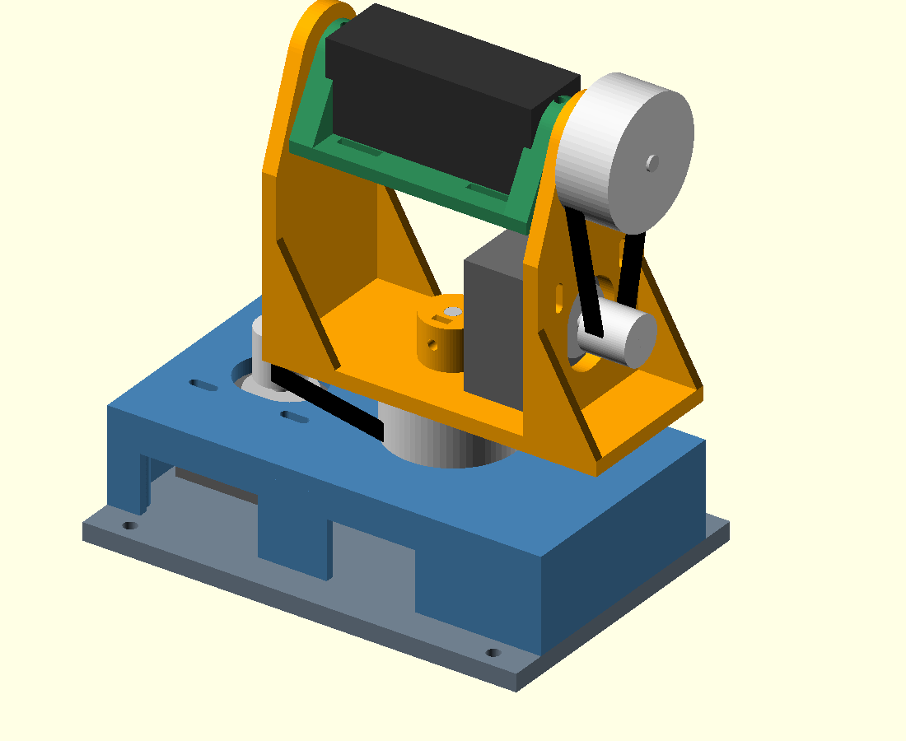

# Stepper head: build guide

A belt-driven pan-tilt head for two pancake NEMA 17 motors, driven by a Raspberry Pi Pico and two TMC2209 drivers. Each axis is a 20T motor pulley driving a 60T pulley through a 200 mm closed GT2 belt (3:1), with the output on a 5 mm shaft in two 625ZZ bearings. The camera sits on a cradle whose platform is 10 mm from the tilt axis, so its weight stays near the pivot. The reference head runs with the cradle inverted and the camera on top.



Photos and video of the built head: *to come.*

Everything on this page is what the reference head was built from. Shopping links are to the Australian shops the reference head's parts came from (amazon.com.au and Jaycar); any part that matches the description works. Several rows share one listing: an M3 screw assortment for the fasteners, and one GT2 listing for the pulleys and belts.

## Printed parts

Print one of each unless the table says otherwise. No part needs supports in the exported orientation. Use four perimeters and about 30 % infill; PETG is better than PLA near the motors.

| File | Print | What |
|------|------:|------|
| [`stl/base_top.stl`](stl/base_top.stl) | 1 | Base deck and walls; holds the pan motor underneath (exported deck-down for printing) |
| [`stl/base_bottom.stl`](stl/base_bottom.stl) | 1 | Bottom plate with the lower pan bearing and hold-down holes |
| [`stl/yoke.stl`](stl/yoke.stl) | 1 | Turntable and two arms; carries the tilt motor and both tilt bearings |
| [`stl/cradle.stl`](stl/cradle.stl) | 1 | Camera platform on the tilt shaft, with strap slots and a 1/4" screw hole. Grips the shaft with a pinch clamp in each hub. The bore is 5.1 mm, nearly rod size; a printed horizontal hole comes out a touch small, so ream it with a 5 mm drill if the rod will not enter |
| [`stl/small_parts.stl`](stl/small_parts.stl) | 1 | One shaft collar and six 1.5 mm spacers |
| [`stl/bushings/`](stl/bushings/) | as needed | Sleeves that adapt an 8 mm pulley bore to a 5 mm shaft: a graded set (8.0 to 8.5 mm, rim notches count the size) and one file per size. Only needed if your 60T pulleys have an 8 mm bore |
| [`stl/pan_bracket.stl`](stl/pan_bracket.stl) | 2 | *Optional.* Pan limit switch bracket, glued to the base deck 95° either side of straight ahead. **Designed for the old ±90° pan travel:** fitted as drawn they trip at about ±95°, so move them (`sw_angle` in `switch_mounts.scad`) before using the ±180° range |
| [`stl/pan_flag.stl`](stl/pan_flag.stl) | 1 | *Optional.* Flag glued under the yoke that presses the pan switch levers |

The sources are parametric OpenSCAD: [`pan_tilt.scad`](pan_tilt.scad) for the head (select a part with `-D 'part="yoke"'`; `assembly` shows everything with mock motors, pulleys and belts) and [`switch_mounts.scad`](switch_mounts.scad) for the switch mounts (`pan_bracket`, `pan_flag` or `assembly`). To re-export a part:

```bash
openscad -D 'part="cradle"' -o stl/cradle.stl pan_tilt.scad
```

## Bill of materials

### Electronics

| Qty | Part | Notes | Where to buy |
|----:|------|-------|-----|
| 1 | Raspberry Pi Pico (RP2040), with headers | Any pin-compatible RP2040 board. Powered from USB, which also carries the protocol | [Amazon](https://www.amazon.com.au/dp/B0C3BWBL2F) |
| 2 | TMC2209 StepStick driver module | The firmware sets the motor current over each driver's UART pin, so the potentiometer does not need adjusting | [Amazon](https://www.amazon.com.au/dp/B0G4QKY33F) |
| 1 | 12 V supply, 2 A or more | A USB-C PD trigger board set to 12 V, or a 12 V adapter. The head draws about 0.8 A at peak | [Jaycar](https://www.jaycar.com.au/usb-c-type-c-pd-trigger-module-supports/p/PP2080) |
| 2 | 100 µF 25 V electrolytic capacitor | One across each driver's motor supply. Optional if the supply has a large output capacitor on short wires | [Jaycar](https://www.jaycar.com.au/100uf-25vdc-low-esr-electrolytic-capacitor/p/RE6322) |
| 1 | Breadboard or perfboard, and jumper wires | To carry the Pico and the two drivers; the wiring is in [`docs/wiring/pico-tmc2209/`](../../docs/wiring/pico-tmc2209/README.md) | *link to come* |
| 1 | USB data cable (Micro-USB or USB-C, to suit the board) | Pico to computer (or Raspberry Pi) | [Amazon](https://www.amazon.com.au/dp/B0BWHTX1R7) |
| 1 | LED and 330 Ω resistor | *Optional* activity light | [Amazon](https://www.amazon.com.au/dp/B0GXYBK7FS) |
| 4 | Endstop module (lever microswitch on a small board, the common 3D-printer type) | *Optional*, two per axis. Supported in the firmware but not yet fitted to the reference head | [Amazon](https://www.amazon.com.au/dp/B0GDCXSZHT) |

### Motion

| Qty | Part | Notes | Where to buy |
|----:|------|-------|-----|
| 2 | NEMA 17 pancake stepper, 1.8°, about 23 mm body, 5 mm shaft | With its motor cable | [Amazon](https://www.amazon.com.au/dp/B0F32H6JNP) |
| 2 | GT2 20T pulley, 5 mm bore, 6 mm belt | On the motor shafts | [Amazon](https://www.amazon.com.au/dp/B0F9YZV8NY) |
| 2 | GT2 60T pulley, 6 mm belt, 5 mm bore (or 8 mm with a printed bushing) | On the output shafts | [Amazon](https://www.amazon.com.au/dp/B0F9YZV8NY) |
| 2 | GT2 closed belt, 200 mm, 6 mm wide | | [Amazon](https://www.amazon.com.au/dp/B0F9YZV8NY) |
| 4 | 625ZZ bearing (5 × 16 × 5 mm) | Two per axis | [Amazon](https://www.amazon.com.au/dp/B0H7ML3WHT) |
| 2 | 5 mm steel rod: 80 mm (pan) and 120 mm or longer (tilt) | Cut from one longer rod if needed | [Amazon](https://www.amazon.com.au/dp/B0D1KH2FN9) or [Amazon](https://www.amazon.com.au/dp/B07MP9Y897) |

### Fasteners

| Qty | Part | Where | Where to buy |
|----:|------|-------|-----|
| 8 | M3 × 8 screw | Motor faces. The motor holes are shallow, so no longer | [Amazon](https://www.amazon.com.au/dp/B0FH4Y4D4J) |
| 6 | M3 × 12 screw | Bottom plate to the base | [Amazon](https://www.amazon.com.au/dp/B0FH4Y4D4J) |
| 2 | M3 × 8 screw + M3 nut | Set screws in the yoke hub and the shaft collar | [Amazon](https://www.amazon.com.au/dp/B0FH4Y4D4J) |
| 2 | M3 × 25 bolt + M3 nut | Pinch clamps on the cradle | [Amazon](https://www.amazon.com.au/dp/B0FH4Y4D4J) |
| 4 | M3 × 8 screw + M3 nut | *Optional:* switch boards to the pan brackets | [Amazon](https://www.amazon.com.au/dp/B0FH4Y4D4J) |
| 1 | 1/4"-20 camera screw, or two zip ties | Camera to the cradle | *link to come* |

### Camera

The reference head carries a Logitech C270 webcam. Anything of similar size and weight that fits a 1/4" screw or a strap works.

## Tools

| Tool | For |
|------|-----|
| 3D printer | The printed parts (PETG or PLA) |
| Hex keys or screwdrivers to suit your M3 screws, and a 1.5 mm hex key | Assembly; the small key is for the pulley grub screws |
| Small spanner (5.5 mm) or pliers | Holding M3 nuts |
| 5 mm drill bit, turned by hand | Reaming the cradle's shaft bore if the rod will not enter |
| File, or a rotary tool with a grinding bit | A small flat on each shaft where a set screw lands |
| Hacksaw or rotary cutting disc | Cutting the 5 mm rod to length, if bought long |
| Soldering iron and solder | Pico and driver headers, capacitors, wiring |
| Wire strippers and side cutters | Wiring |
| Multimeter | Confirming 12 V before connecting, and finding each motor's coil pairs |
| Superglue or epoxy | *Optional:* the switch brackets and the flag |
| Computer with USB (Linux, macOS, or a Raspberry Pi) | Building and flashing the firmware, and driving the head: see [`docs/GETTING_STARTED.md`](../../docs/GETTING_STARTED.md) |

## Assembly

The pulley centre distance, 58.6 mm, follows from the tooth counts and the belt length; the motor mounts are slotted ±3 mm for tension. Before starting, grind a small flat on each shaft where a set screw lands.

### Base and pan axis

1. Bolt the pan motor under the deck, screws loose in the slots, connector towards a side window.
2. Press a bearing into the deck and one into the bottom plate.
3. Slide the pan shaft down through the deck bearing and thread the collar onto it inside the box.
4. Screw on the bottom plate so the shaft end seats in the lower bearing.
5. Push the collar up against the deck bearing and tighten it through the window.
6. On top: spacer, 60T pulley, spacer, then the yoke.
7. Fit the 20T pulley and the belt, slide the motor away to tension it, tighten the motor screws.

### Tilt axis and cradle

1. Bolt the tilt motor to its yoke arm, screws loose in the slots.
2. Press the two tilt bearings into the yoke arms from the outside faces.
3. Hold the cradle between the arms with a spacer between each cheek and its arm, and slide the tilt shaft through: bearing, spacer, cradle, spacer, bearing. Outside the motor arm, thread on a spacer and then the 60T pulley. (The `assembly` view of `pan_tilt.scad` shows the order.)
4. Fit the 20T pulley and the belt, tension it as for pan, tighten the motor screws.
5. Close each cradle hub with its M3 × 25 pinch bolt, so the cradle grips the shaft without slipping under the camera.
6. Fit the camera with the 1/4" screw or a strap.

### Electronics

Wire the Pico and the drivers as in [`docs/wiring/pico-tmc2209/`](../../docs/wiring/pico-tmc2209/README.md), which also gives a staged bring-up order. Then build and flash the firmware and run the first checks as in [`docs/GETTING_STARTED.md`](../../docs/GETTING_STARTED.md). Centre both axes by hand before the first `owlet enable`: the head takes the pose it is in at enable as the one you give it.

## As built

- **Pulleys (2026-10-05):** the 60T pulleys supplied had an 8 mm bore, not 5 mm. The reference head runs on printed 8.1 mm PLA bushings (`stl/bushings/single_8.1.stl`); 8.15 mm and 8.2 mm would not enter the bore. Metal 5-to-8 mm bushes are the better long-term fit. The model's pulley dimensions (the values marked MEASURE in the source) only position the mock-ups in the assembly view and do not change any printed part.
- **Cradle (2026-10-09):** the first cradle gripped the shaft with a set screw, which slipped under the camera's weight and cracked the hub when tightened. The pinch clamp replaced it.
- **Limit switches:** the pan mounts are designed but not yet fitted, and the firmware has them switched off (`kLimitSwitchesFitted` in [`apps/pico-owlet/board.hpp`](../../apps/pico-owlet/board.hpp)). Tilt mounts are still to come.
- **Travel (2026-10-09):** the assembled head was swept through pan ±180° and tilt ±135° (tilt zero straight up), and those are its saved limits; see [`docs/CALIBRATION.md`](../../docs/CALIBRATION.md).
